<p align="center"></p>
<h1 align="center">PhotoFrame</h1>
<p align="center">Film formats, clean borders, map overlays, camera stickers and photo collages.</p>
<p align="center"><a href="README.md">简体中文</a> · English · <a href="#interface-tour">UI tour</a> · <a href="#quick-start">Quick start</a> · <a href="#creative-tools-collections-and-delivery">Creative tools</a> · <a href="docs/PhotoFrame-使用说明.pdf">Chinese PDF guide</a> · <a href="TECHNICAL_SPEC.md">Technical design</a></p>

PhotoFrame is a browser-based photo framing and layout tool. Import photographs, choose a film format, adjust borders and captions, add stickers or arrange a collage, then export JPEG / PNG files or a batch ZIP. Decoding and rendering happen locally; using the editor does not require uploading photographs or creating an account.

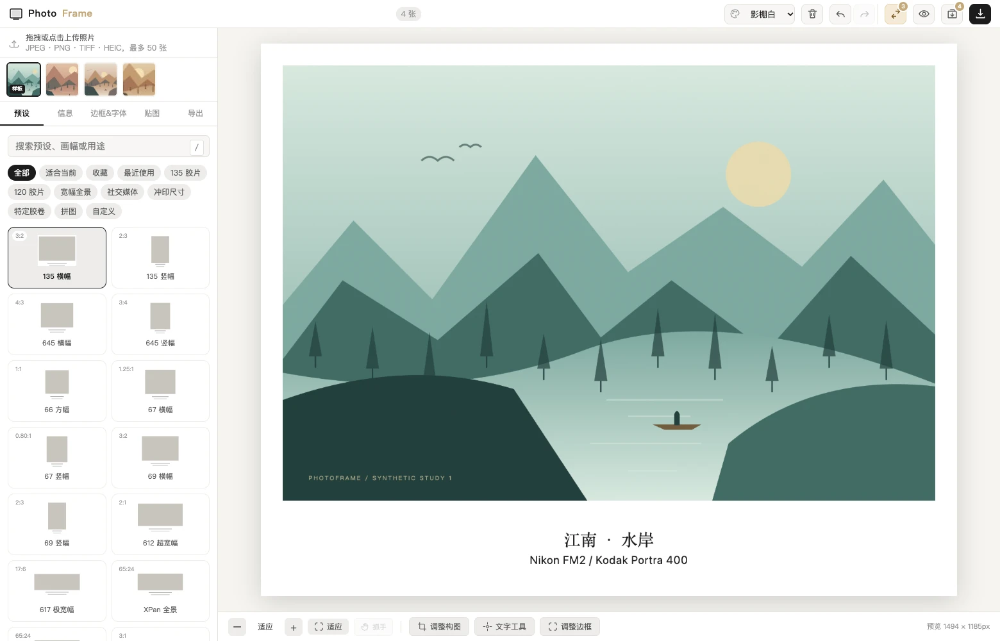

_Actual application UI. The landscapes are generated locally, with no personal photographs. Camera, film and location fields contain manually entered example information. The current interface uses Simplified Chinese; this guide explains its controls in English._

## Features

| Area                        | Capabilities                                                                                                                                                      |
| --------------------------- | ----------------------------------------------------------------------------------------------------------------------------------------------------------------- |
| **Formats and presets**     | 30 single-image presets covering 135, 120 formats, XPan, 612 / 617, social and print layouts; search, favorites, recent presets and aspect-ratio recommendations  |
| **Film borders**            | 133 film stocks, including 85 with a 120 edition. Search names and aliases, filter by format and film type, and customize edge lettering with EXIF variables. |
| **Composition**             | Crop, rotate 90° left or right, and flip horizontally or vertically. The crop follows the photograph. |
| **Borders and backgrounds** | Independent margins, rounded corners, solid / gradient / paper / linen / grain / halftone backgrounds, strokes and shadows, with draggable inner and outer frames |
| **Captions**                | Available EXIF fields plus manual location and film information; title / subtitle templates, extra text, fonts, alignment, positioning and transforms             |
| **Stickers**                | 320 built-in entries across 9 category controls: film, vector / cutout cameras and decorations; personal uploads, scale, rotation, opacity, strokes and shadows   |
| **Map overlays**            | Mountain contours, city streets and waterways. Choose a place by name, coordinates or photo GPS, then customize the pin, fade and background. |
| **Collages**                | 18 layouts with image slots, canvas ratios, whitespace, gaps, corners, materials, alignment, titles and photo ordering                                            |
| **Batch editing**           | Up to 72 photographs, a bottom filmstrip with navigation and multi-selection, guided style synchronization, undo / redo, original comparison and ZIP export                                              |
| **Original-resolution export** | Thumbnail-based editing with full-resolution source rendering by default for single-image and ZIP exports. Borders expand the canvas. |
| **Local workspace**         | Four UI themes, mobile bottom-sheet controls, local session recovery and preset JSON backup / restore                                                             |
| **Creative tools** | Photo palettes, imported fonts/signatures, photo picks, complete projects, JPEG/PDF contact sheets, export recipes and continuous carousels |

Counts refer to the current `1.0.0` data. EXIF availability depends on the source file; film stock and location usually need manual entry.

## Quick start

Runtime dependencies are already included in `vendor/`. No frontend build is needed:

```bash
git clone https://github.com/JackerKun/PhotoFrame.git
cd PhotoFrame
python3 -m http.server 8080 --bind 127.0.0.1
```

Open **http://127.0.0.1:8080**. On Windows, use `py -m http.server 8080 --bind 127.0.0.1` if `python3` is unavailable. Use a local HTTP server so asset loading and the service worker can work correctly.

1. Import your photographs, or download the [synthetic demo source](docs/screenshots/demo-photo.jpg).
2. Each photo starts with the closest aspect-ratio preset and its full image intact. Use **预设** (Presets) to choose a different format or a film border.
3. Switch photos in the bottom filmstrip. Open **调整构图** (Adjust composition) to crop, rotate or flip. Use **信息** (Information) to add location or film details.
4. Choose JPEG or PNG under **导出** (Export). The default uses the original resolution. Save one image or a ZIP from the top toolbar.

JPEG / PNG / TIFF / HEIC / HEIF decoding is local. Exact compatibility depends on the file encoding and browser memory. The demo source contains no real shooting EXIF.

## Interface tour

These screenshots use four synthetic demo images on desktop and in a 390-pixel-wide mobile viewport. Click a WebP screenshot for a larger view.

### Add a film border

Open **预设 → 胶片边框** (Presets → Film borders) and filter by 135 or 120, color or black-and-white negative, reversal, or motion picture negative. The main search under **全部** (All) also finds names and aliases such as `Fuji`, `Fuji Provia`, and `Portra 400`. The simulated 135 border has white sprocket holes by default, with a color picker. The 120 border has continuous edges. Both formats offer dark film base, light scan, and cinema scan styles.

Edit either edge with plain text and variables such as `{stock} · {frame} · {camera} · {shutter} · {iso}`. Available EXIF values are printed on the border. Edit the edge lettering directly after selecting a stock. You can save the result as a custom preset.

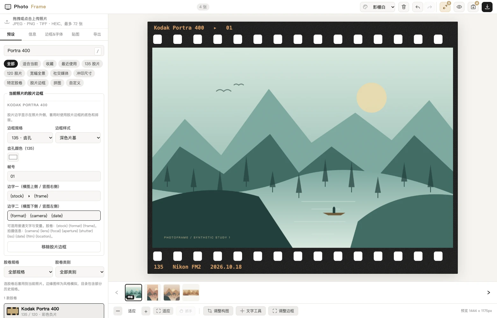

### Adjust composition

Open **调整构图** (Adjust composition) beneath the canvas. Drag to reposition the crop, scroll or pinch to zoom, or nudge with the arrow keys. Rotate 90° left or right, or flip horizontally or vertically. The crop follows the transformation. Choose **完成构图** (Finish composition) or press Enter to apply it to the preview and export. Escape cancels composition. Entering composition exits border adjustment and hides its guides.

Built-in panorama presets now use more balanced top and side margins. Untouched legacy defaults are updated when restoring a session; custom margins and per-photo overrides are retained.

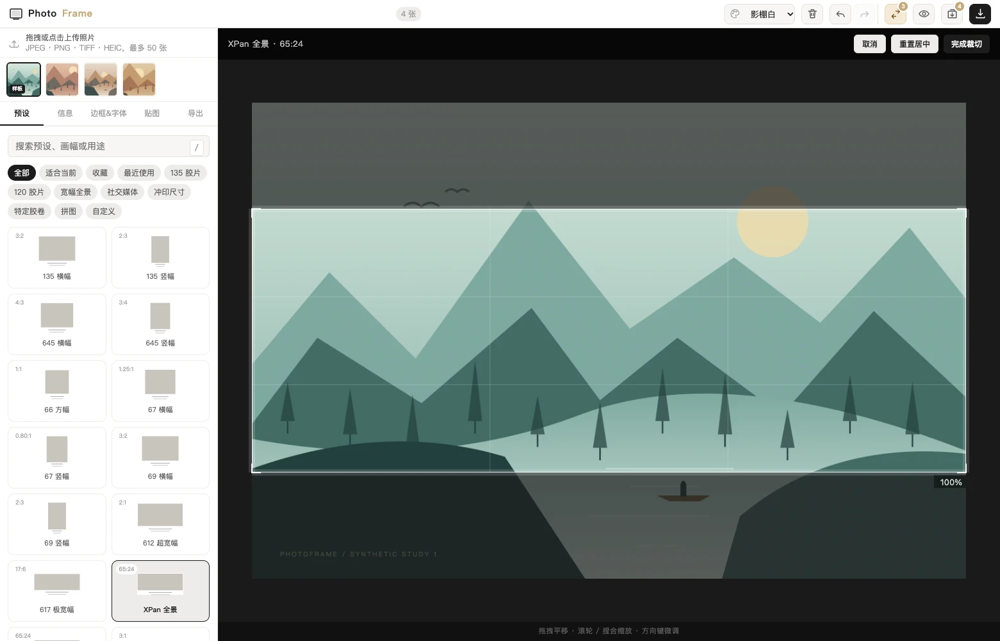

### Edit borders directly on the canvas

**Open:** import → **边框&字体**. Adjust margins and background, then choose **调整边框** (Adjust borders) below the preview. Drag corner / edge handles. **文字工具** (Text tool) lets you reposition caption blocks.

The panel has seven collapsible groups for backgrounds, border dimensions, photo edges, typography, text effects, extra lines and text position. Expand or collapse all groups at once; fold states are remembered, with current settings summarized in each header. Titles, subtitles and extra lines share 49 font choices covering common Windows and macOS fonts. Detected local fonts appear first, with sample previews and recent choices. Other device fonts remain selectable with system substitution when missing; browser privacy settings may limit detection.

Batch ZIP export opens a progress dialog with the current thumbnail, filename, waiting queue, success/failure states and ZIP packing progress. Cancel stops after the current operation without downloading the ZIP. Errors appear directly in the queue, with a retry button for failed photos only. Duplicate filenames receive unique suffixes. Close it with **完成** when processing finishes. Horizontal lists include navigation arrows and edge hints, and keep selected items visible. A regular mouse wheel scrolls sticker categories, tags and the photo filmstrip horizontally when they overflow.

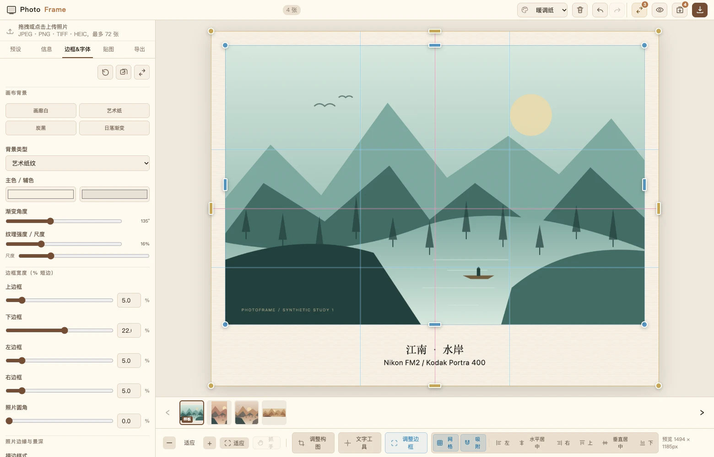

### Add film, camera and personal stickers

**Open:** **贴图** → choose a category or search → click an asset. Move, resize and rotate it on the canvas, or adjust opacity, strokes, shadows and layer order in the panel. Personal PNG / JPG / WebP / SVG assets are supported.

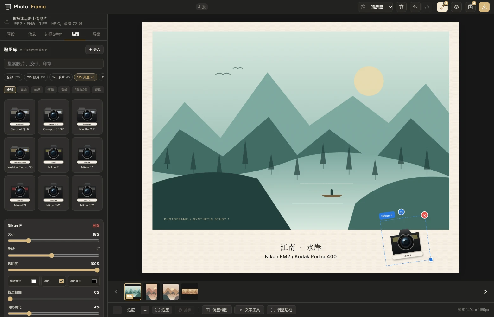

Vector camera illustrations and transparent camera cutouts are separate categories. Photographic assets retain their own source / license links; see [Assets and licenses](#assets-and-licenses).

### Add a map overlay

1. Import a photo and open **贴图 → 地图叠层** (Stickers → Map overlay). Choose mountain contours or city streets and waterways.
2. Load the built-in Val di Funes or Saint Petersburg sample, search for a place, enter latitude and longitude, or choose **使用照片 GPS** (Use photo GPS). Set the map width and generate the map.
3. Click the small map to move the red pin. Drag the overlay onto sky or open space in the photo. Map width sets the geographic coverage, while sticker size sets the size on the photo. Coordinates, a scale bar and a north arrow are optional. Mountain maps can also show approximate elevation.
4. Choose a transparent or custom background with independent opacity. Use dark lines directly on a white border, or pair a dark background with warm white lines for a map card. The lower-edge fade blends the linework into the photo.

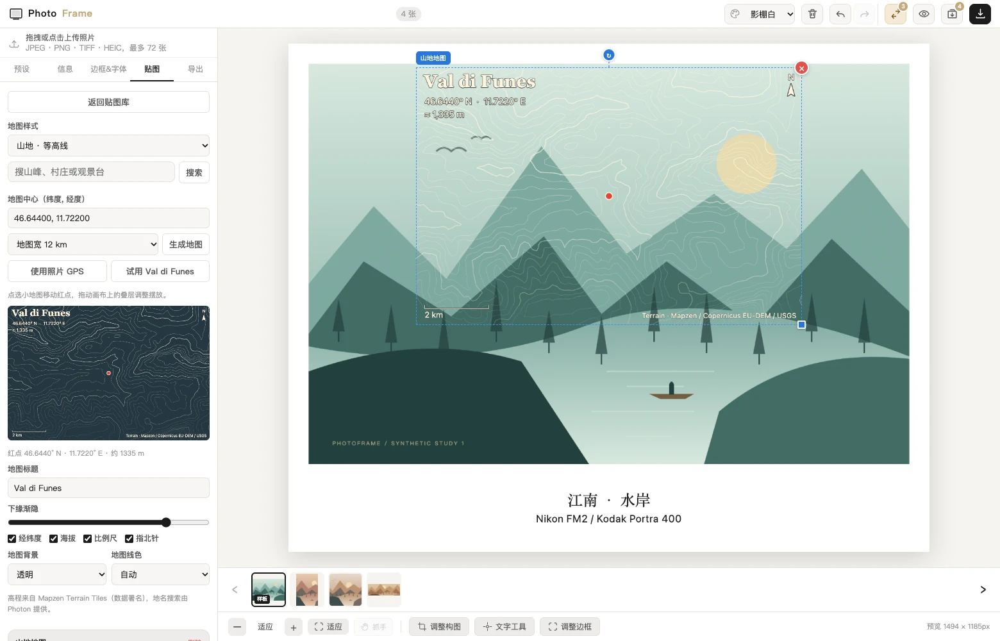

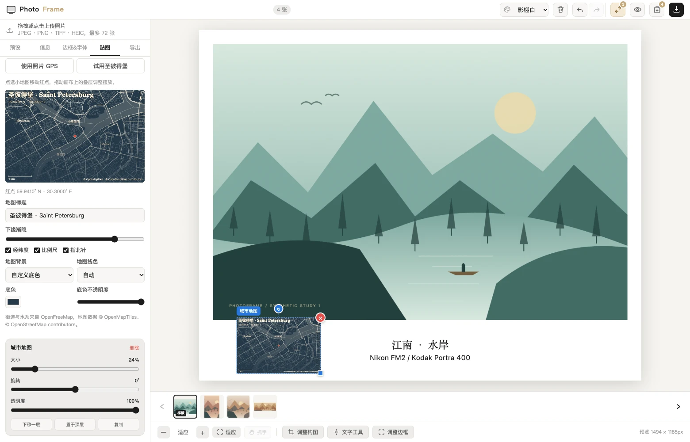

The built-in samples work offline. Searching for new places and loading new areas require internet access. Photo composition and session storage happen locally. Single-image and ZIP exports redraw the map at the output dimensions, and original-resolution mode uses the source photo. See [map data and credits](assets/maps/README.md). [Place search service](https://github.com/komoot/photon)

### Assemble a collage in one workspace

**Keyboard:** Escape closes the photo picker or cancels cell composition before closing the collage. Press Enter to finish cell composition.

**Appearance:** The collage picker and editor follow the app theme, including Studio, Darkroom, Warm and Midnight.

**Open:** click **拼图** (Collage) in the top toolbar. Follow **Choose a style → Choose photos → Edit and export**. The existing **预设 → 拼图** entry also leads to photo selection.

1. Choose from 18 layout previews. Each new composition uses the layout you just selected.
2. Select photos from the library or click **上传照片** to import files directly. New imports fill the remaining selection slots; extra photos stay in the library.
3. Numbered badges show the cell order. Use **前移 / 后移 / 移除** to reorder or remove photos. **开始编辑** becomes available once the required number is selected.
4. Replace or add photos on the left, compose on the canvas, adjust grouped settings on the right and manage pages below. Click **导出拼图** to download the result.
5. Use **继续上次拼图** explicitly to resume your saved composition. Browsing layouts or cancelling the start window preserves it; starting a new composition replaces it.

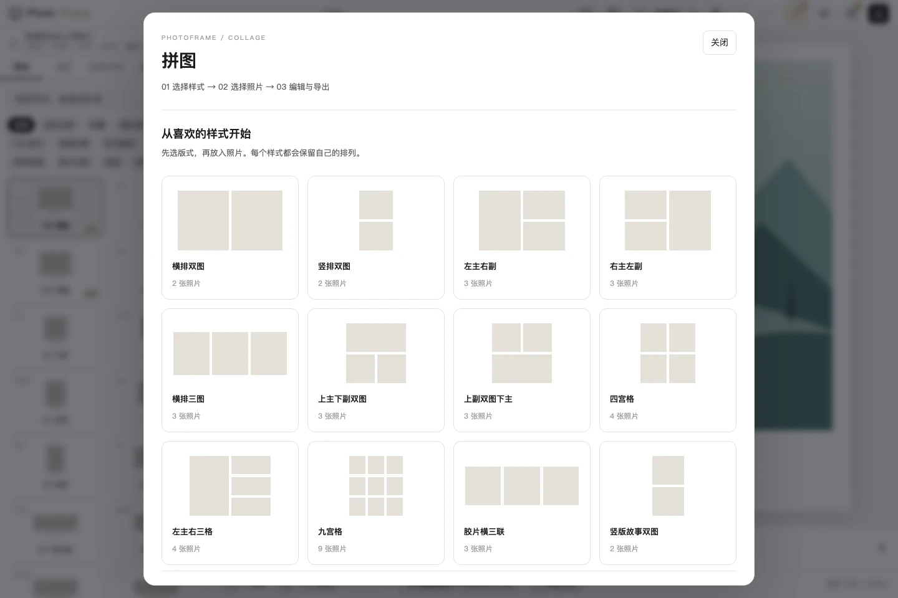

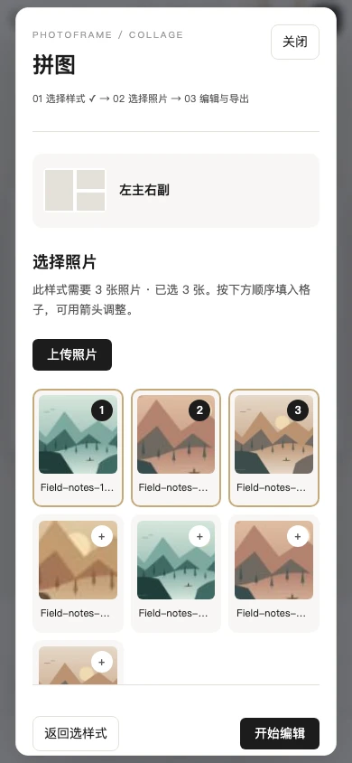

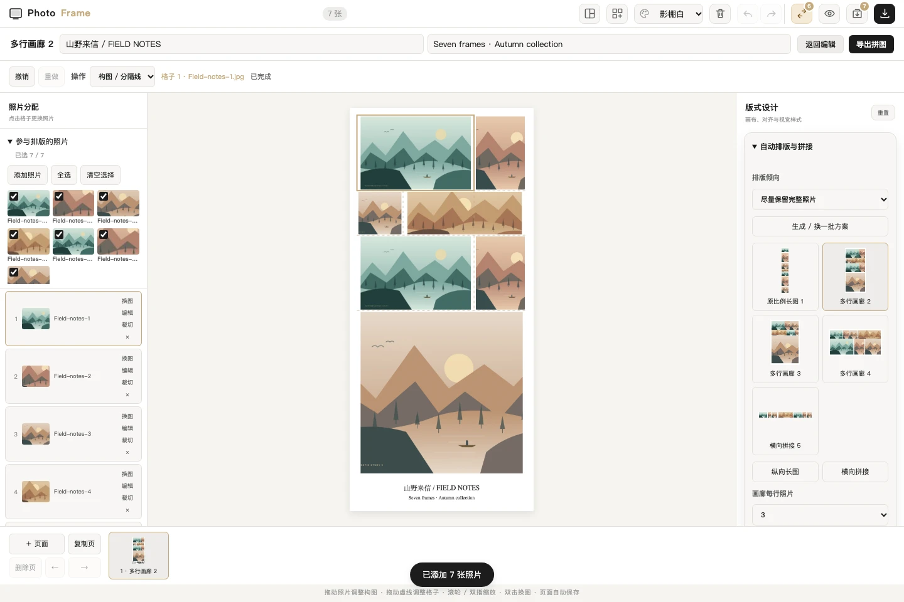

#### Automatic layouts and original-ratio stitching

Select photos, choose preserve / cover / hero mode, then generate candidate thumbnails. Click a candidate to apply it. Set a hero photo or lock a cell to preserve its photo and rectangle while rearranging the other areas. Cover layouts account for source aspect ratios; no face detection is performed.

Vertical stitching uses equal widths, horizontal stitching uses equal heights, and the gallery supports 2–6 photos per row. All three preserve complete photographs. Switch built-in layouts without clearing captions or crop focal points; photos that do not fit remain in the source library.

#### Direct canvas editing

Multi-photo layouts use a separate memory-bounded preview cache. Continuous zoom updates are coalesced per animation frame, and unchanged pages retain their thumbnails. Previews use downsampled images; exports still render from the originals.

In composition mode, drag inside a photo to pan, use the wheel or a two-finger pinch to zoom, and drag dashed dividers to resize neighboring cells. Complete-photo and framed modes do not apply an additional crop. In swap mode, drag onto another cell to exchange photos with their captions. Locked cells cannot be dragged or swapped.

Selected cells can be split horizontally / vertically or merged with a neighbor sharing a full edge. Merging retains the first selected photo; other originals remain in the library. Double-click a cell to replace its image. Independent collage undo / redo keeps 50 steps, including pagination, with Ctrl / Cmd + Z and Shift + Ctrl / Cmd + Z.

#### Photography layouts and reusable designs

Use originals, snapshots of each photo's current frame / text / sticker / crop edits, uniform white borders or film borders. Reapply snapshots after changing a source photo's edits. Add individual captions or generate filenames, sequence numbers or camera / lens / date captions, with a shared font and color.

Save up to 30 named designs containing geometry, styles, titles and captions without photographs. Saving the same name replaces it. Saved designs are included in complete projects.

#### Multiple pages and export

Add, duplicate, delete and select pages in the bottom strip. Drag pages to reorder on desktop or use the arrow buttons on mobile. Automatically paginate selected photos, optionally using the first and last photos as cover and ending pages. Pagination replaces the book and can be undone. Up to 72 pages and 72 cells per page are supported.

Share the current page's style across the book while preserving photos, layouts and text. To unify page ratios, choose an explicit canvas ratio before sharing. The top export button saves the current page; the multi-page controls export all pages as an ordered JPEG / PNG ZIP, or join equal-ratio pages into one horizontal strip. Set the export long edge to 320–12000 px; continuous strips are limited to 30000 px wide and 64 million pixels.

Send a page to **作品工具 → 连续多页** as a grouped composition for moving, scaling, spanning pages and slice export. Edit its internal cells in the collage workbench and send another copy to update it.

On mobile, switch with the Canvas / Photos / Layout buttons or swipe between panels. The page strip also supports vertical-wheel-to-horizontal scrolling. Books are saved with the browser session, and `.photoframe` archives include all pages and saved designs. Recovery of originals still requires original-photo persistence to be enabled.

<details>
<summary>Batch sync: unify the style while keeping each image's content</summary>

**Open:** finish one sample image → top double-arrow button. Choose following, selected or all other photographs. Defaults synchronize frame style, text styling and stickers while preserving per-image text and crop composition. Enable text content / crop only when needed. The operation can be undone as a single step.

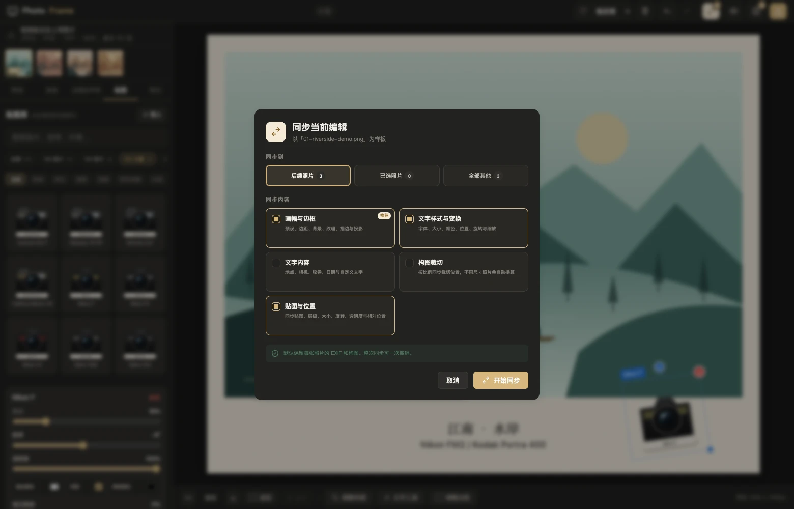

</details>

<details>
<summary>Export: JPEG / PNG, quality, resolution and filename templates</summary>

**Open:** **导出**. JPEG quality ranges from 70–100%. Export uses the original resolution by default. You can manually set the photo long edge to 1500 / 2400 / 3000 / 4500 / 6000 pixels. Use filename variables such as `{name}` and `{index}`, then save one image or a batch ZIP. See the sizing notes below.

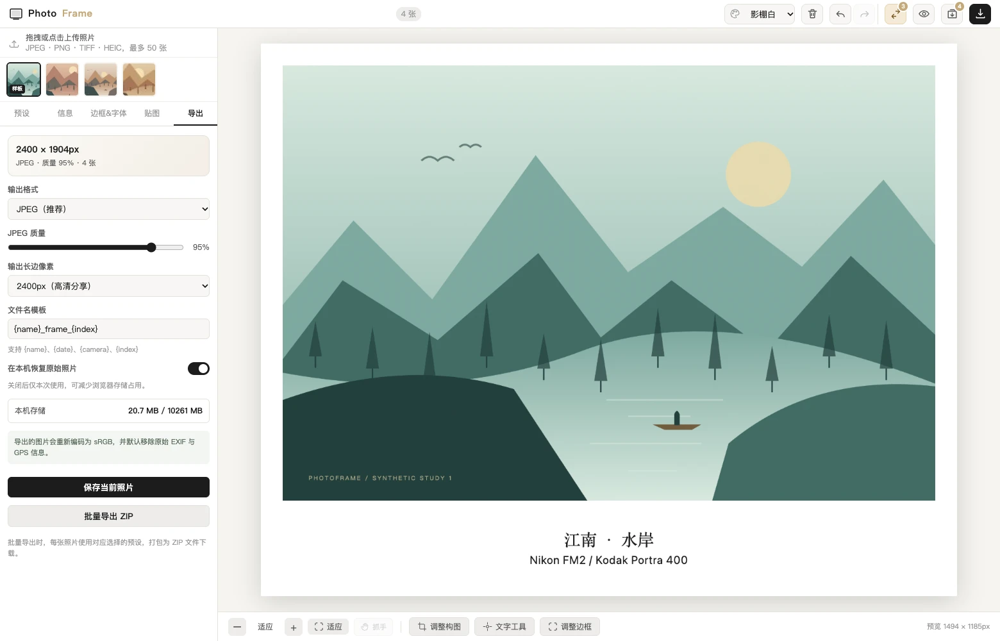

</details>

### Use the mobile preview and bottom-sheet controls

The bottom navigation switches presets, information, borders / fonts, stickers and export. Tools open in a bottom sheet; tap the backdrop to return to the preview. Canvas controls use compact icons with zoom and hand panning.

<p align="center">
  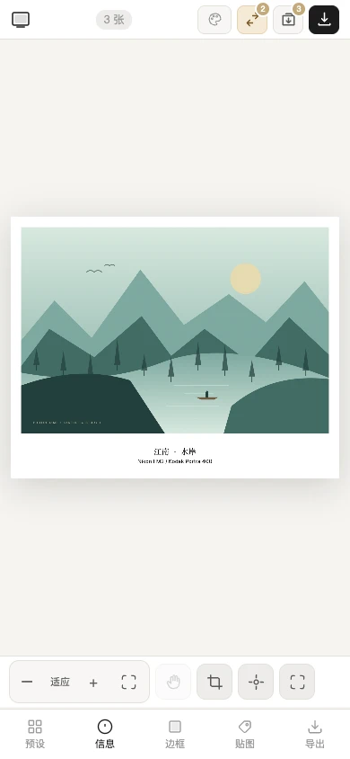
  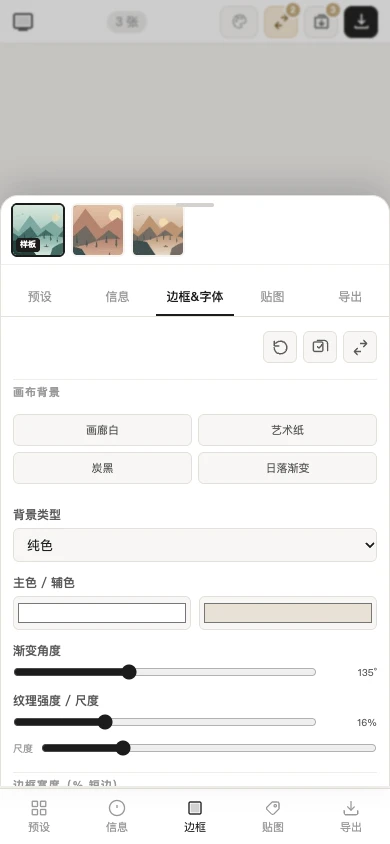
</p>

<details>
<summary>Example of an actual exported image</summary>

This WebP is converted from a real JPEG export for documentation. Download the [original exported JPEG](docs/screenshots/result.jpg) to inspect it. The example uses a 2400-pixel photo long edge and produces **2560 × 2032 pixels** after adding borders.

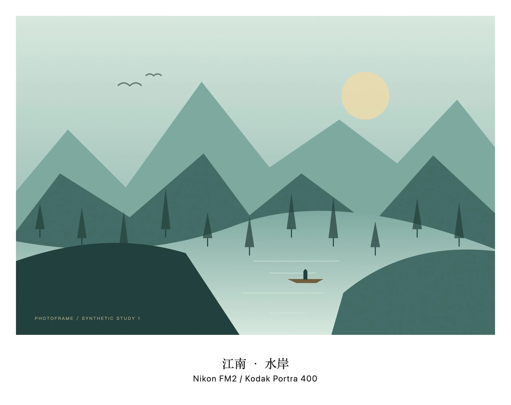

</details>

## Suggested workflow

**One photograph:** import → format → information → border / text / stickers → check composition → save.

**A consistent series:**

1. Import the set and finish the first sample image.
2. Choose the sync tool and a target range. Recommended options preserve each image's information and crop.
3. Scroll the bottom filmstrip or use its previous and next buttons. When the filmstrip has focus, use ← / →. Use `Ctrl / ⌘` to toggle sync targets or `Shift` to select a range.
4. Refine individual captions and composition, then export a ZIP.

Save a style using **将当前参数保存为预设**. Export a preset JSON backup before switching devices or clearing browser storage, then import it to restore the presets.

Title / subtitle variables include `{location}`, `{camera}`, `{film}`, `{date}`, `{iso}`, `{aperture}`, `{shutter}` and `{lens}`. They use existing EXIF / manually entered information; they do not infer film stock from image pixels.

## Creative tools: collections and delivery

Open **作品工具** with the four-square toolbar button, or use the shortcuts in the background, typography or export panels. The tabs are **配色与签名** (palette/signatures), **选片** (picks), **工程** (projects), **联系表** (contact sheets), **多规格导出** (export recipes) and **连续多页** (carousels). The header and scope stay visible while the cards scroll. On phones, cards stack vertically and the tab bar scrolls horizontally.

Choose the **处理范围** scope first: all photographs, kept photographs, pending photographs or filmstrip-selected photographs. It controls palette/signature application, bulk marking, contact sheets, recipe exports and automatic carousel layouts. **Filmstrip filtering only changes visibility; the original batch ZIP button still exports all photographs.**

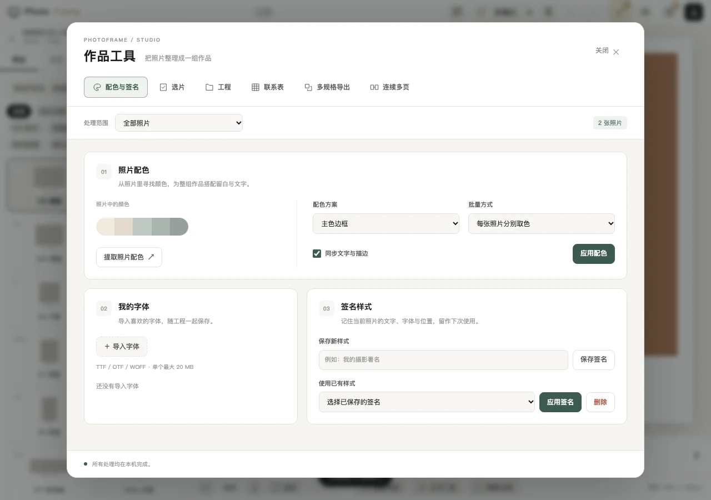

### Extract a photo palette

1. Select the reference photograph in the filmstrip and open **配色与签名**.
2. Click **提取照片配色** to extract up to six colors, then select a swatch. A solid-color image may yield only one.
3. Choose dominant, light or dark framing, and optionally match the text and stroke colors.
4. Choose individual color extraction for each photo or a shared selected color for the set. Check the scope and click **应用配色**.

Both plain and film borders support palettes. Changing the film's light/dark style restores that style's default colors.

### Import fonts and reuse signatures

Click **导入字体** in the font card to import TTF/OTF/WOFF/WOFF2 files, up to 20 MB each. Imported fonts appear in the editor's title, subtitle and extra-line font lists. They stay in this browser and are embedded in complete projects.

First finish the current photo's text templates, fonts, alignment and position in the editor. Enter a name in the signature card and click **保存签名**. To reuse it, select a saved style and click **应用签名**. This replaces the targets' title, subtitle and extra-line settings; their EXIF and manual information remain, so template variables still resolve per photo. **删除** removes the saved style without undoing captions already applied.

### Mark and filter photographs

In **选片**, click a thumbnail to change the current photo and use its menu to mark keep, pending or reject. New photographs are pending. **胶片条筛选** filters the filmstrip; bulk marking uses the top-level scope. Rejecting a photograph does not delete its original. To deliver only your picks, set the scope to **仅保留**, then open contact sheets or export recipes. Picks persist in the session and complete projects.

### Save and reopen a complete project

Click **保存 .photoframe 工程** in **工程**. To reopen it, choose **选择工程文件**, wait for validation, review the summary and click **打开已检查的工程**. Opening replaces the workspace, so save the current project first.

Archives include originals, per-photo edits, presets, custom stickers, imported fonts, signatures, all collage pages and saved designs, carousel, recipes and delivery settings. Archive and expanded size are both limited to 1 GB; available memory may impose a lower practical limit. When original-photo persistence is off, imported originals work for this session but are not stored for session recovery.

| Save method | Contents | Use |
| --- | --- | --- |
| Preset JSON | Custom presets and preset-management information; no originals | Back up or share styles |
| Local session recovery | Edits in this browser/origin; originals depend on the persistence switch | Continue after a refresh |
| Complete `.photoframe` project | Originals, edits, fonts, custom assets and layouts | Durable backup or moving between browsers/devices |

Complete projects retain the original metadata, including available GPS; they are not sanitized image exports.

### Export a contact sheet

1. Open **联系表**, enter a title and choose 2-8 columns and rows per page.
2. Select clean or dark film styling, with optional filename, date and camera labels. Sequence numbers and pick markers always appear.
3. Click **预览首页** to inspect the first page; preview again after changing the layout.
4. Choose **导出 JPG** for paginated images in a ZIP or **导出 PDF** for a multipage document. Extra photographs paginate automatically. PDF pages contain raster images.

### Export multiple sizes together

1. In **多规格导出**, enable the recipes you need; add, name or remove recipes, up to 12.
2. Set width, height and contain/cover fitting. Contain preserves the full composition with background padding; cover crops the excess. Width zero preserves the ratio and uses height as the long-edge setting; borders may enlarge the final dimensions.
3. Choose JPEG or PNG. The JPEG size cap is in MB; zero means unlimited. Meeting it may reduce quality and dimensions. PNG ignores this cap.
4. Metadata sidecars default to none. Optionally include camera/lens/date JSON without GPS, or explicitly select GPS JSON. The image itself always omits original EXIF/GPS; visible caption text remains.
5. Select the photo in the filmstrip. In the crop-check card choose a recipe, adjust horizontal/vertical placement and click **预览并估算大小**. Offsets are saved per photo and recipe, and primarily affect cover fitting.
6. Click **导出所选方案 ZIP**. Files are grouped by recipe; the included report lists actual dimensions and byte sizes. Preview again after changing settings.

### Arrange a continuous carousel

1. In **连续多页**, set 2-10 pages, a background, and dimensions of 320-2400 px wide by 320-3000 px tall per page.
2. Add the current photo or text. **自动排版** replaces existing carousel elements with a layout using the scoped photographs.
3. Uncheck **滑动浏览** to drag elements across page boundaries. Choose an element in **编辑元素** for precise coordinates, dimensions, rotation, fitting, font and text controls.
4. Change layer order or delete the selected element. Deleting an element does not remove its source photograph. Check **滑动浏览** to pan the canvas; it is enabled by default on phones. Mouse wheels scroll horizontally and arrow buttons advance pages.
5. Toggle **参考线** for page/safe-area guides, then click **切页导出 ZIP** for sequential JPEG pages. Guides and selection outlines are excluded.

Carousels persist locally and in projects. Removing a source photo removes its corresponding carousel elements. Reopen the carousel tab to refresh photo previews after editing the source.

Long-running exports and archive packing show progress and can be cancelled without downloading partial results; cancellation may wait for the current photo to finish.

## Export and offline behavior

| Question                                       | Behavior                                                                                                                                                                                                                                                      |
| ---------------------------------------------- | ------------------------------------------------------------------------------------------------------------------------------------------------------------------------------------------------------------------------------------------------------------- |
| **Why is the export larger than 2400 pixels?** | Single-image resolution refers to the photo area's long edge; borders enlarge the final canvas.                                         |
| **Does original size include borders?**        | Original-resolution export renders from the source file. The full photo keeps its pixel dimensions and the border expands the canvas. After manual cropping, the retained area determines the size.                                                                                                                                     |
| **What happens to metadata?**                  | Canvas exports do not copy the source EXIF / GPS. Visible caption text remains. The source file is not overwritten.                                                                                                                                           |
| **Does it work offline?**                      | A local HTTP server uses bundled resources without an external connection. For remote hosting, load and refresh first so the service worker can take control. Only previously cached resources are available offline; on-demand assets must be visited first. |
| **Where did my previous session go?**          | Session files use IndexedDB for the current browser and origin; presets / preferences use localStorage. Changing ports, browsers, private mode or clearing site data affects restoration.                                                                     |
| **Why did import / export fail?**              | Codec variations and browser memory affect HEIC / TIFF and large exports. Try JPEG / PNG, a smaller output or fewer photographs at once.                                                                                                                      |

Preset JSON backups do not contain source photographs. Use **作品工具 → 工程** for a complete project with originals, fonts and layouts. For printing, check actual pixel dimensions, paper size and the output provider's requirements separately.

## Development

Node.js is not required to use the editor. For dependency maintenance, checks and screenshot generation, use Node.js 20+ (a current LTS is recommended):

```bash
npm ci
npm run vendor               # When refreshing the bundled dependencies
npm run check
npx playwright install chromium
npm test
```

The project uses vanilla JavaScript, HTML5 Canvas, exifr, heic2any, UTIF, JSZip and FileSaver.js. Playwright covers desktop and mobile viewports. See [TECHNICAL_SPEC.md](TECHNICAL_SPEC.md).

Run `node scripts/screenshots.cjs` to reproduce the documentation with isolated browser contexts and synthetic inputs. Google Chrome is used by default. See [capture notes](docs/screenshots/README.md) for browser and output overrides.

The Chinese PDF manual is generated from the user-facing sections of `README.md`. Rebuild it with Python, `reportlab` and a Chinese-capable TrueType font:

```bash
python3 -m pip install reportlab
python3 scripts/build-user-guide.py --font /path/to/chinese.ttf
```

On macOS the script tries Arial Unicode automatically. Use `--font` or `PHOTOFRAME_DOC_FONT` elsewhere.

## Source layout

- `index.html`, `css/`: entry point and responsive UI.
- `js/` contains editing state, aspect-ratio presets, the film-stock catalog, map overlays, rendering, composition and collage tools, stickers, EXIF, local decoding, session storage and export.
- `assets/`: camera assets and attribution records.
- `vendor/`: bundled browser dependencies.
- `docs/screenshots/`: UI captures, a demo source and the real exported example.
- `scripts/`, `tests/`: maintenance tools and Playwright tests.
- `sw.js`, `manifest.webmanifest`: offline cache and web-app metadata.

## Assets and licenses

`package.json` declares MIT for project code. Third-party dependencies and image assets retain their own licenses. See [camera-photo attribution](assets/cameras/ATTRIBUTION.json) and [camera-cutout attribution](assets/camera-cutouts/ATTRIBUTION.json); these assets are not uniformly licensed under the code's license. The UI also provides source / license links.

The README landscapes are generated by the capture script and contain no personal photographs. Report issues with browser, file format and reproduction steps in [Issues](https://github.com/JackerKun/PhotoFrame/issues).
