<p align="center"></p>
<h1 align="center">PhotoFrame</h1>
<p align="center">Film formats, clean borders, map overlays, camera stickers and photo collages.</p>
<p align="center"><a href="README.md">简体中文</a> · English · <a href="#interface-tour">UI tour</a> · <a href="#quick-start">Quick start</a> · <a href="TECHNICAL_SPEC.md">Technical design</a></p>

PhotoFrame is a browser-based photo framing and layout tool. Import photographs, choose a film format, adjust borders and captions, add stickers or arrange a collage, then export JPEG / PNG files or a batch ZIP. Decoding and rendering happen locally; using the editor does not require uploading photographs or creating an account.

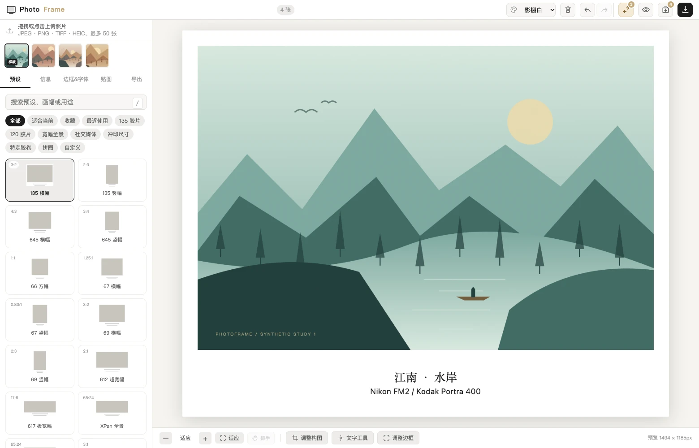

_Actual application UI. The landscapes are generated locally, with no personal photographs. Camera, film and location fields contain manually entered example information. The current interface uses Simplified Chinese; this guide explains its controls in English._

## Features

| Area                        | Capabilities                                                                                                                                                      |
| --------------------------- | ----------------------------------------------------------------------------------------------------------------------------------------------------------------- |
| **Formats and presets**     | 30 single-image presets covering 135, 120 formats, XPan, 612 / 617, social and print layouts; search, favorites, recent presets and aspect-ratio recommendations  |
| **Film borders**            | 133 film stocks, including 85 with a 120 edition. Search names and aliases, filter by format and film type, and customize edge lettering with EXIF variables. |
| **Composition**             | Crop, rotate 90° left or right, and flip horizontally or vertically. The crop follows the photograph. |
| **Borders and backgrounds** | Independent margins, rounded corners, solid / gradient / paper / linen / grain / halftone backgrounds, strokes and shadows, with draggable inner and outer frames |
| **Captions**                | Available EXIF fields plus manual location and film information; title / subtitle templates, extra text, fonts, alignment, positioning and transforms             |
| **Stickers**                | 320 built-in entries across 9 category controls: film, vector / cutout cameras and decorations; personal uploads, scale, rotation, opacity, strokes and shadows   |
| **Map overlays**            | Mountain contours, city streets and waterways. Choose a place by name, coordinates or photo GPS, then customize the pin, fade and background. |
| **Collages**                | 18 layouts with image slots, canvas ratios, whitespace, gaps, corners, materials, alignment, titles and photo ordering                                            |
| **Batch editing**           | Up to 72 photographs, a bottom filmstrip with navigation and multi-selection, guided style synchronization, undo / redo, original comparison and ZIP export                                              |
| **Original-resolution export** | Thumbnail-based editing with full-resolution source rendering by default for single-image and ZIP exports. Borders expand the canvas. |
| **Local workspace**         | Four UI themes, mobile bottom-sheet controls, local session recovery and preset JSON backup / restore                                                             |

Counts refer to the current `1.0.0` data. EXIF availability depends on the source file; film stock and location usually need manual entry.

## Quick start

Runtime dependencies are already included in `vendor/`. No frontend build is needed:

```bash
git clone https://github.com/JackerKun/PhotoFrame.git
cd PhotoFrame
python3 -m http.server 8080 --bind 127.0.0.1
```

Open **http://127.0.0.1:8080**. On Windows, use `py -m http.server 8080 --bind 127.0.0.1` if `python3` is unavailable. Use a local HTTP server so asset loading and the service worker can work correctly.

1. Import your photographs, or download the [synthetic demo source](docs/screenshots/demo-photo.jpg).
2. Each photo starts with the closest aspect-ratio preset and its full image intact. Use **预设** (Presets) to choose a different format or a film border.
3. Switch photos in the bottom filmstrip. Open **调整构图** (Adjust composition) to crop, rotate or flip. Use **信息** (Information) to add location or film details.
4. Choose JPEG or PNG under **导出** (Export). The default uses the original resolution. Save one image or a ZIP from the top toolbar.

JPEG / PNG / TIFF / HEIC / HEIF decoding is local. Exact compatibility depends on the file encoding and browser memory. The demo source contains no real shooting EXIF.

## Interface tour

These screenshots use four synthetic demo images on desktop and in a 390-pixel-wide mobile viewport. Click a WebP screenshot for a larger view.

### Add a film border

Open **预设 → 胶片边框** (Presets → Film borders) and filter by 135 or 120, color or black-and-white negative, reversal, or motion picture negative. The main search under **全部** (All) also finds names and aliases such as `Fuji`, `Fuji Provia`, and `Portra 400`. The simulated 135 border has white sprocket holes by default, with a color picker. The 120 border has continuous edges. Both formats offer dark film base, light scan, and cinema scan styles.

Edit either edge with plain text and variables such as `{stock} · {frame} · {camera} · {shutter} · {iso}`. Available EXIF values are printed on the border. Edit the edge lettering directly after selecting a stock. You can save the result as a custom preset.

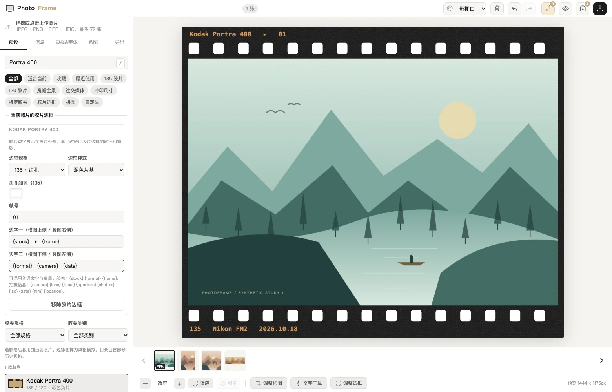

### Adjust composition

Open **调整构图** (Adjust composition) beneath the canvas. Drag to reposition the crop, scroll or pinch to zoom, or nudge with the arrow keys. Rotate 90° left or right, or flip horizontally or vertically. The crop follows the transformation. Choose **完成构图** (Finish composition) to apply it to the preview and export.

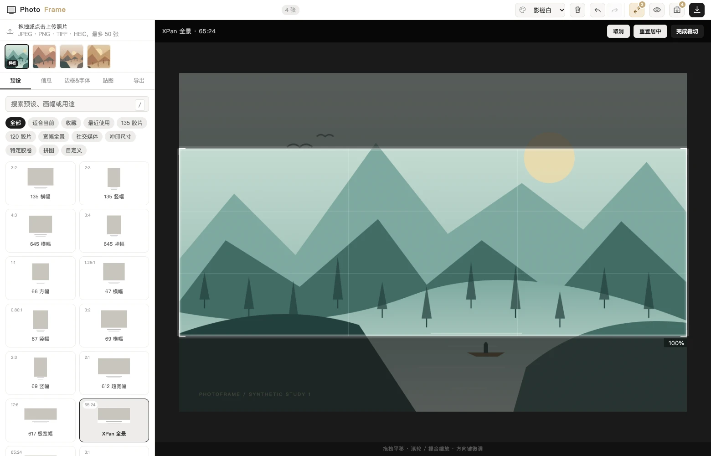

### Edit borders directly on the canvas

**Open:** import → **边框&字体**. Adjust margins and background, then choose **调整边框** (Adjust borders) below the preview. Drag corner / edge handles. **文字工具** (Text tool) lets you reposition caption blocks.

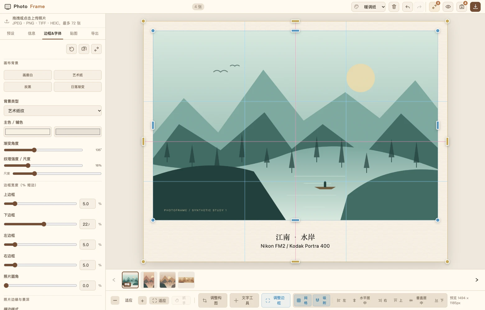

### Add film, camera and personal stickers

**Open:** **贴图** → choose a category or search → click an asset. Move, resize and rotate it on the canvas, or adjust opacity, strokes, shadows and layer order in the panel. Personal PNG / JPG / WebP / SVG assets are supported.

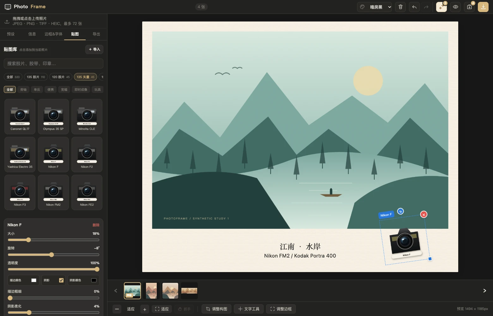

Vector camera illustrations and transparent camera cutouts are separate categories. Photographic assets retain their own source / license links; see [Assets and licenses](#assets-and-licenses).

### Add a map overlay

1. Import a photo and open **贴图 → 地图叠层** (Stickers → Map overlay). Choose mountain contours or city streets and waterways.
2. Load the built-in Val di Funes or Saint Petersburg sample, search for a place, enter latitude and longitude, or choose **使用照片 GPS** (Use photo GPS). Set the map width and generate the map.
3. Click the small map to move the red pin. Drag the overlay onto sky or open space in the photo. Map width sets the geographic coverage, while sticker size sets the size on the photo. Coordinates, a scale bar and a north arrow are optional. Mountain maps can also show approximate elevation.
4. Choose a transparent or custom background with independent opacity. Use dark lines directly on a white border, or pair a dark background with warm white lines for a map card. The lower-edge fade blends the linework into the photo.

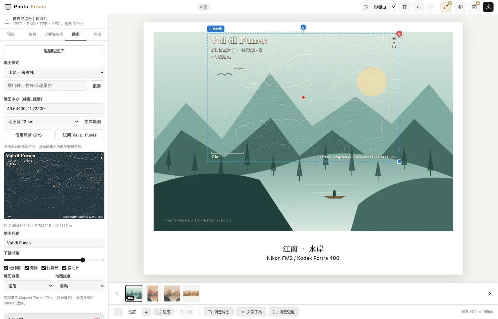

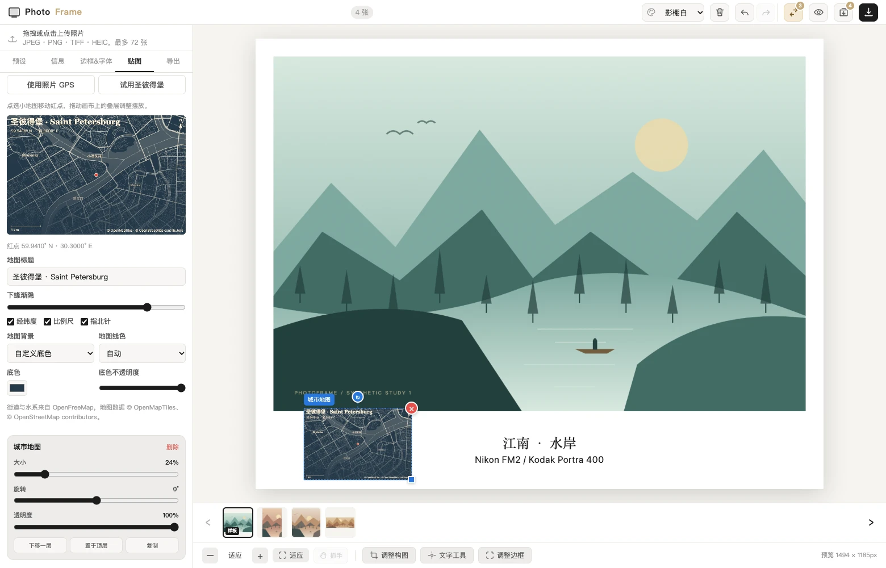

The built-in samples work offline. Searching for new places and loading new areas require internet access. Photo composition and session storage happen locally. Single-image and ZIP exports redraw the map at the output dimensions, and original-resolution mode uses the source photo. See [map data and credits](assets/maps/README.md). [Place search service](https://github.com/komoot/photon)

### Assemble a collage in one workspace

**Open:** **预设** → **拼图** (Collage) → select a layout. Set image slots on the left, preview in the center and adjust ratio, whitespace, gaps, corners, strokes, shadows and material on the right. Add titles above, then choose **导出拼图** (Export collage).

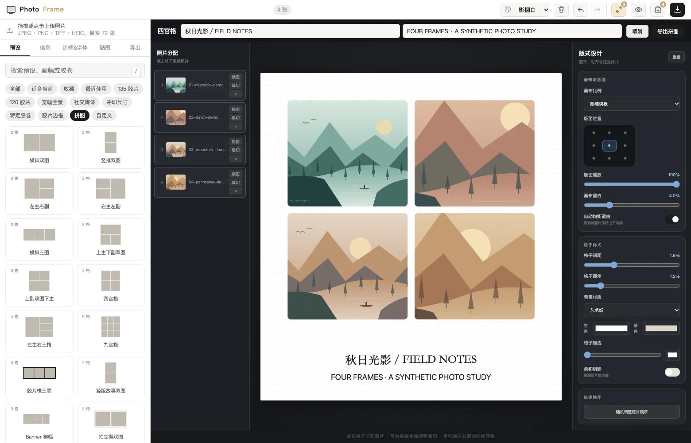

<details>
<summary>Batch sync: unify the style while keeping each image's content</summary>

**Open:** finish one sample image → top double-arrow button. Choose following, selected or all other photographs. Defaults synchronize frame style, text styling and stickers while preserving per-image text and crop composition. Enable text content / crop only when needed. The operation can be undone as a single step.

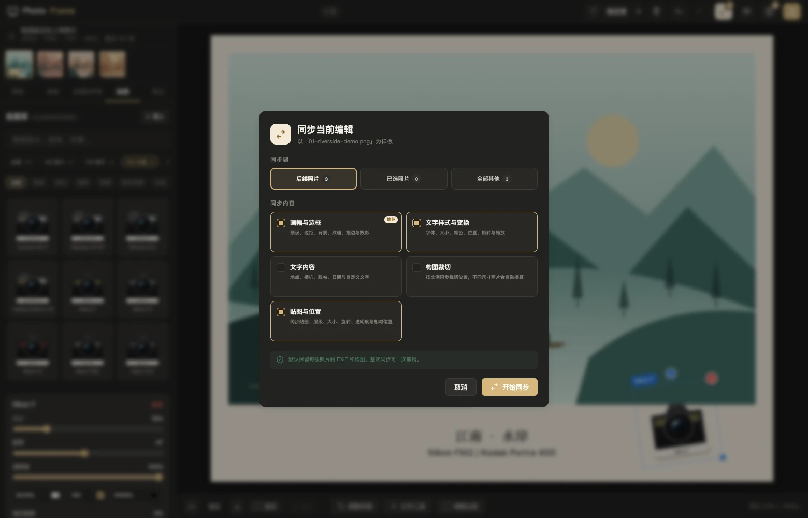

</details>

<details>
<summary>Export: JPEG / PNG, quality, resolution and filename templates</summary>

**Open:** **导出**. JPEG quality ranges from 70–100%. Export uses the original resolution by default. You can manually set the photo long edge to 1500 / 2400 / 3000 / 4500 / 6000 pixels. Use filename variables such as `{name}` and `{index}`, then save one image or a batch ZIP. See the sizing notes below.

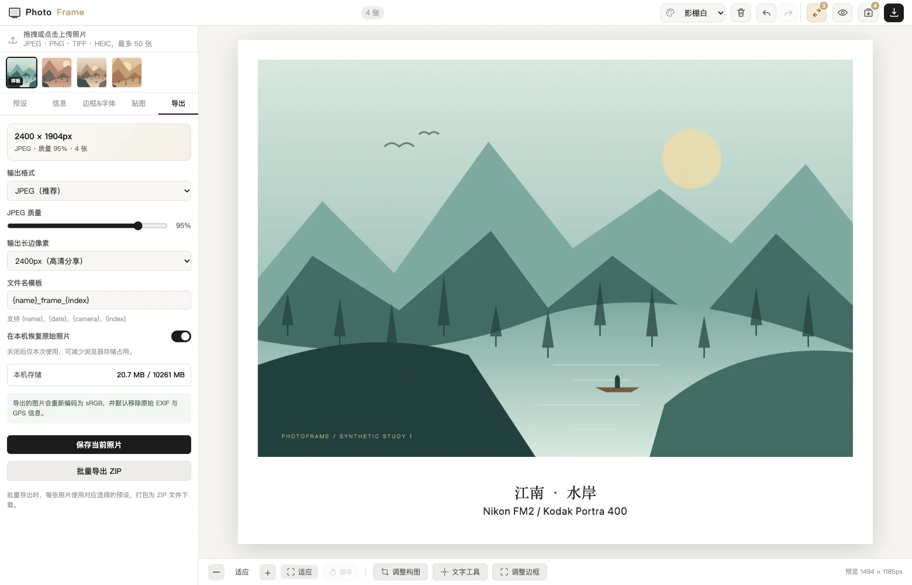

</details>

### Use the mobile preview and bottom-sheet controls

The bottom navigation switches presets, information, borders / fonts, stickers and export. Tools open in a bottom sheet; tap the backdrop to return to the preview. Canvas controls use compact icons with zoom and hand panning.

<p align="center">
  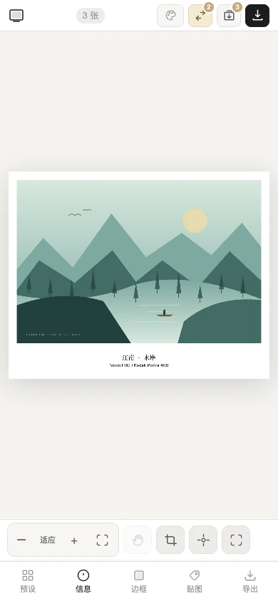
  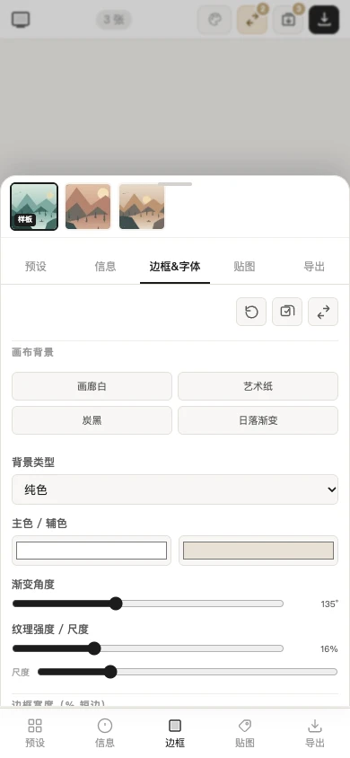
</p>

<details>
<summary>Example of an actual exported image</summary>

This WebP is converted from a real JPEG export for documentation. Download the [original exported JPEG](docs/screenshots/result.jpg) to inspect it. The example uses a 2400-pixel photo long edge and produces **2560 × 2032 pixels** after adding borders.

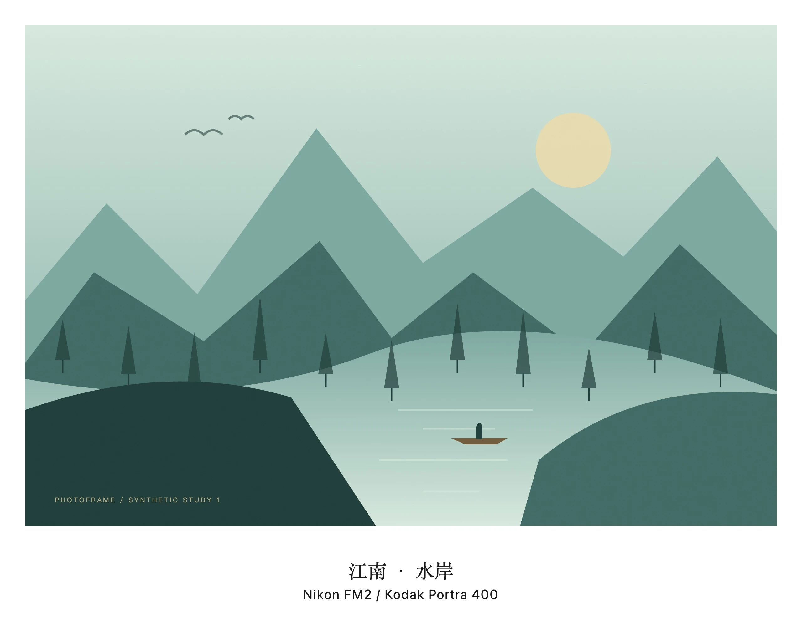

</details>

## Suggested workflow

**One photograph:** import → format → information → border / text / stickers → check composition → save.

**A consistent series:**

1. Import the set and finish the first sample image.
2. Choose the sync tool and a target range. Recommended options preserve each image's information and crop.
3. Scroll the bottom filmstrip or use its previous and next buttons. When the filmstrip has focus, use ← / →. Use `Ctrl / ⌘` to toggle sync targets or `Shift` to select a range.
4. Refine individual captions and composition, then export a ZIP.

Save a style using **将当前参数保存为预设**. Export a preset JSON backup before switching devices or clearing browser storage, then import it to restore the presets.

Title / subtitle variables include `{location}`, `{camera}`, `{film}`, `{date}`, `{iso}`, `{aperture}`, `{shutter}` and `{lens}`. They use existing EXIF / manually entered information; they do not infer film stock from image pixels.

## Export and offline behavior

| Question                                       | Behavior                                                                                                                                                                                                                                                      |
| ---------------------------------------------- | ------------------------------------------------------------------------------------------------------------------------------------------------------------------------------------------------------------------------------------------------------------- |
| **Why is the export larger than 2400 pixels?** | Single-image resolution refers to the photo area's long edge; borders enlarge the final canvas.                                         |
| **Does original size include borders?**        | Original-resolution export renders from the source file. The full photo keeps its pixel dimensions and the border expands the canvas. After manual cropping, the retained area determines the size.                                                                                                                                     |
| **What happens to metadata?**                  | Canvas exports do not copy the source EXIF / GPS. Visible caption text remains. The source file is not overwritten.                                                                                                                                           |
| **Does it work offline?**                      | A local HTTP server uses bundled resources without an external connection. For remote hosting, load and refresh first so the service worker can take control. Only previously cached resources are available offline; on-demand assets must be visited first. |
| **Where did my previous session go?**          | Session files use IndexedDB for the current browser and origin; presets / preferences use localStorage. Changing ports, browsers, private mode or clearing site data affects restoration.                                                                     |
| **Why did import / export fail?**              | Codec variations and browser memory affect HEIC / TIFF and large exports. Try JPEG / PNG, a smaller output or fewer photographs at once.                                                                                                                      |

Preset JSON backups do not contain source photographs and are not photo / session backups. For printing, check actual pixel dimensions, paper size and the output provider's requirements separately.

## Development

Node.js is not required to use the editor. For dependency maintenance, checks and screenshot generation, use Node.js 20+ (a current LTS is recommended):

```bash
npm ci
npm run vendor               # When refreshing the bundled dependencies
npm run check
npx playwright install chromium
npm test
```

The project uses vanilla JavaScript, HTML5 Canvas, exifr, heic2any, UTIF, JSZip and FileSaver.js. Playwright covers desktop and mobile viewports. See [TECHNICAL_SPEC.md](TECHNICAL_SPEC.md).

Run `node scripts/screenshots.cjs` to reproduce the documentation with isolated browser contexts and synthetic inputs. Google Chrome is used by default. See [capture notes](docs/screenshots/README.md) for browser and output overrides.

## Source layout

- `index.html`, `css/`: entry point and responsive UI.
- `js/` contains editing state, aspect-ratio presets, the film-stock catalog, map overlays, rendering, composition and collage tools, stickers, EXIF, local decoding, session storage and export.
- `assets/`: camera assets and attribution records.
- `vendor/`: bundled browser dependencies.
- `docs/screenshots/`: UI captures, a demo source and the real exported example.
- `scripts/`, `tests/`: maintenance tools and Playwright tests.
- `sw.js`, `manifest.webmanifest`: offline cache and web-app metadata.

## Assets and licenses

`package.json` declares MIT for project code. Third-party dependencies and image assets retain their own licenses. See [camera-photo attribution](assets/cameras/ATTRIBUTION.json) and [camera-cutout attribution](assets/camera-cutouts/ATTRIBUTION.json); these assets are not uniformly licensed under the code's license. The UI also provides source / license links.

The README landscapes are generated by the capture script and contain no personal photographs. Report issues with browser, file format and reproduction steps in [Issues](https://github.com/JackerKun/PhotoFrame/issues).
