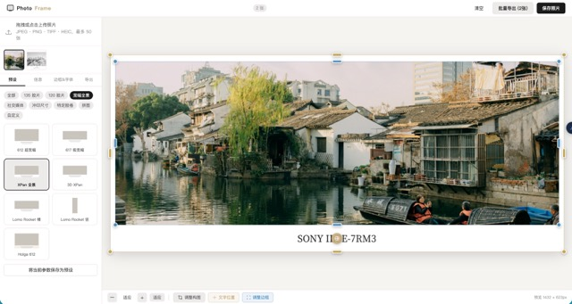

# PhotoFrame

> 胶片照片加边框排版工具，专为胶片摄影爱好者打造。



---

## 简介

PhotoFrame 是一款运行在浏览器中的纯前端照片排版工具。上传胶片照片后，选择对应画幅的预设，自动填入相机、胶卷、地点等拍摄信息，实时预览生成带留白边框的成品图，一键导出高清 JPEG 或 PNG，无需安装任何软件，无需联网，隐私友好。

---

## 功能特性

### 预设系统
- **28+ 内置预设**，覆盖主流胶片画幅：
  - 135 胶片（横 3:2 / 竖 2:3）
  - 120 胶片（645 / 66 方幅 / 67 / 69）
  - 宽幅全景（612 / 617 / XPan / 3D XPan / Lomo Rocket）
  - 社交媒体（小红书首图 / 横三排）
  - 冲印尺寸（大六寸 / 七寸 / 八寸）
  - 特定胶卷风格（Kodak Gold 200 / Ultramax / NC500）
- **自定义预设**：在任意内置预设基础上修改并命名保存，跨会话持久
- 预设搜索、收藏、最近使用，并根据当前照片画幅推荐

### 边框编辑
- 四边独立宽度调节（相对短边百分比，0–40%）
- 照片圆角调节
- 背景支持纯色、线性/径向渐变、艺术纸、亚麻、胶片颗粒与网点纹理
- 照片描边、双线边框、投影、模糊与偏移控制
- **可视化拖拽调整**：点击「调整边框」按钮，直接拖拽四角或四边句柄调整边框大小
  - 四角句柄：等比例缩放全部四边
  - 四边句柄：自由独立调节对应单边

### 信息文字
- 主标题 + 副标题双行显示
- 支持模板变量自动填充：`{location}` `{camera}` `{film}` `{date}` `{iso}` `{aperture}` `{shutter}` `{lens}`
- 自动读取 EXIF：相机型号、镜头、光圈、快门、ISO、拍摄日期
- 主/副标题独立字体选择（系统宋体 / Georgia / 系统字体）
- 字号、字色、对齐方式（左 / 居中 / 右）自由调节
- 额外文字行：支持添加多行自定义文字
- 文字位置拖拽：点击「文字位置」按钮，直接拖拽定位文字块
- 类 Photoshop 自由变换：画布上拖动、拖角缩放、旋转柄旋转，支持水平/垂直翻转

### 拼图与主题
- 拼图格子间距、圆角、描边、阴影与纹理背景实时预览
- 影棚白、暗房黑、暖调纸张、深夜蓝 4 套 UI 主题，自动记忆选择

### 照片处理
- 拖拽或点击上传，支持 JPEG / PNG / TIFF / HEIC（全部在本机解码），最多 50 张
- 画幅裁切编辑：拖拽平移、滚轮缩放、方向键微调
- 多张照片胶片条管理，支持 Ctrl/Cmd 多选
- 胶片条支持 Ctrl/⌘ 逐张增减选择、Shift 连续范围选择；当前样板不会因多选而切换
- 放大预览后自动启用抓手工具，可直接在画布上按住拖动查看边缘细节
- 撤销/重做、按住对比原图；顶部工具栏采用图标操作，悬停即可查看说明
- **引导式批量同步**：将当前照片作为样板，可同步到后续、已选或全部其他照片
- 默认只同步画幅、边框、背景和文字样式，保留每张照片自己的 EXIF、文字内容与裁切构图
- 文字内容和比例裁切可按需单独开启；整次同步可一次撤销

### 多张照片的推荐流程
1. 一次导入全部照片，先完成第一张的画幅、边框、背景和文字样式。
2. 点击顶部双向箭头图标，默认选择「后续照片」。
3. 保持推荐选项即可批量统一风格；需要完全一致时，再开启「文字内容」或「构图裁切」。
4. 逐张微调构图和信息，最后使用批量导出。

### 批量导出
- 全部照片一键打包为 ZIP 下载
- 每张照片可单独绑定不同预设
- 导出格式：JPEG（可调质量 70–100%）/ PNG
- 输出长边：1500 / 2400 / 3000 / 4500 / 6000px 或原始尺寸
- 可自定义文件名模板，批量导出会汇总失败项
- 导出时统一为 sRGB 并默认移除 EXIF/GPS 信息

### 会话恢复
- 关闭页面后重新打开，可选自动恢复上次照片与参数，并显示本机存储占用
- 所有依赖均已本地化，首次打开后由 Service Worker 提供离线访问

---

## 快速开始

首次开发需安装并同步本地依赖；正常使用时不需构建：

```bash
npm install
npm run vendor

# Python 3
python3 -m http.server 8080
```

然后打开浏览器访问 `http://localhost:8080`。

运行质量检查：

```bash
npm run check
npm test
```

---

## 文件结构

```
photoframe/
├── index.html              # 主入口
├── css/
│   └── style.css           # 全部样式
├── js/
│   ├── app.js              # 主控制器
│   ├── presets.js          # 28+ 内置预设数据
│   ├── exif-reader.js      # EXIF 读取封装
│   ├── canvas-renderer.js  # Canvas 渲染引擎
│   ├── crop-editor.js      # 裁切编辑器
│   ├── collage-layouts.js  # 拼图布局
│   ├── storage.js          # 自定义预设持久化
│   ├── session-store.js    # 会话存储
│   └── batch-processor.js  # 批量处理 & ZIP 导出
├── TECHNICAL_SPEC.md       # 技术规格文档
└── ui.jpeg                 # 界面截图
```

---

## 技术栈

| 层次 | 选型 |
|------|------|
| 框架 | 原生 JavaScript，无构建工具 |
| 渲染 | HTML5 Canvas API |
| EXIF | exifr 7（本地依赖） |
| HEIC / TIFF | heic2any + UTIF（本地解码） |
| 批量导出 | JSZip + FileSaver.js（本地依赖） |
| 字体 | macOS / Windows 系统字体 + Georgia |
| 存储 | localStorage（自定义预设） + IndexedDB（会话文件） |
| 测试 | Playwright（桌面端 + 移动端） |

---

## 边框参数说明

所有边框宽度均以照片「短边」为基准，取值范围 0–40%：

```
总画布宽 = 照片宽 + 左边框 + 右边框
总画布高 = 照片高 + 上边框 + 下边框
边框像素 = 短边像素 × 比例值
```

例：135 横幅默认预设 `top=5%  bottom=22%  left=5%  right=5%`，下方留白较大用于放置信息文字。

---

## 许可

MIT
