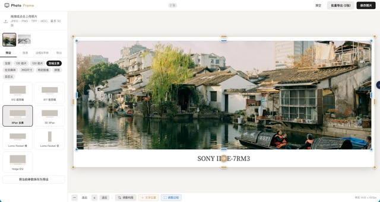

# PhotoFrame

> 胶片照片加边框排版工具，专为胶片摄影爱好者打造。



---

## 简介

PhotoFrame 是一款运行在浏览器中的纯前端照片排版工具。上传胶片照片后，选择对应画幅的预设，自动填入相机、胶卷、地点等拍摄信息，实时预览生成带留白边框的成品图，一键导出高清 JPEG 或 PNG，无需安装任何软件，无需联网，隐私友好。

---

## 功能特性

### 预设系统
- **28+ 内置预设**，覆盖主流胶片画幅：
  - 135 胶片（横 3:2 / 竖 2:3）
  - 120 胶片（645 / 66 方幅 / 67 / 69）
  - 宽幅全景（612 / 617 / XPan / 3D XPan / Lomo Rocket）
  - 社交媒体（小红书首图 / 横三排）
  - 冲印尺寸（大六寸 / 七寸 / 八寸）
  - 特定胶卷风格（Kodak Gold 200 / Ultramax / NC500）
- **自定义预设**：在任意内置预设基础上修改并命名保存，跨会话持久

### 边框编辑
- 四边独立宽度调节（相对短边百分比，0–40%）
- 照片圆角调节
- 背景颜色自由选取
- **可视化拖拽调整**：点击「调整边框」按钮，直接拖拽四角或四边句柄调整边框大小
  - 四角句柄：等比例缩放全部四边
  - 四边句柄：自由独立调节对应单边

### 信息文字
- 主标题 + 副标题双行显示
- 支持模板变量自动填充：`{location}` `{camera}` `{film}` `{date}` `{iso}` `{aperture}` `{shutter}` `{lens}`
- 自动读取 EXIF：相机型号、镜头、光圈、快门、ISO、拍摄日期
- 主/副标题独立字体选择（宋体 Noto Serif SC / EB Garamond / Georgia / 系统字体）
- 字号、字色、对齐方式（左 / 居中 / 右）自由调节
- 额外文字行：支持添加多行自定义文字
- 文字位置拖拽：点击「文字位置」按钮，直接拖拽定位文字块

### 照片处理
- 拖拽或点击上传，支持 JPEG / PNG / TIFF / HEIC，最多 100 张
- 画幅裁切编辑：拖拽平移、滚轮缩放、方向键微调
- 多张照片胶片条管理，支持 Ctrl/Cmd 多选

### 批量导出
- 全部照片一键打包为 ZIP 下载
- 每张照片可单独绑定不同预设
- 导出格式：JPEG（可调质量 70–100%）/ PNG
- 输出长边：1500 / 2400 / 3000 / 4500 / 6000px 或原始尺寸

### 会话恢复
- 关闭页面后重新打开，自动恢复上次照片与参数

---

## 快速开始

无需构建工具，直接用本地 HTTP 服务器启动：

```bash
# Python 3
python3 -m http.server 8080
```

然后打开浏览器访问 `http://localhost:8080`。

---

## 文件结构

```
photoframe/
├── index.html              # 主入口
├── css/
│   └── style.css           # 全部样式
├── js/
│   ├── app.js              # 主控制器
│   ├── presets.js          # 28+ 内置预设数据
│   ├── exif-reader.js      # EXIF 读取封装
│   ├── canvas-renderer.js  # Canvas 渲染引擎
│   ├── crop-editor.js      # 裁切编辑器
│   ├── collage-layouts.js  # 拼图布局
│   ├── storage.js          # 自定义预设持久化
│   ├── session-store.js    # 会话存储
│   └── batch-processor.js  # 批量处理 & ZIP 导出
├── TECHNICAL_SPEC.md       # 技术规格文档
└── ui.jpeg                 # 界面截图
```

---

## 技术栈

| 层次 | 选型 |
|------|------|
| 框架 | 原生 JavaScript，无构建工具 |
| 渲染 | HTML5 Canvas API |
| EXIF | exifr 7（CDN） |
| 批量导出 | JSZip + FileSaver.js（CDN） |
| 字体 | Noto Serif SC + EB Garamond（Google Fonts） |
| 存储 | localStorage（自定义预设） + IndexedDB（会话文件） |

---

## 边框参数说明

所有边框宽度均以照片「短边」为基准，取值范围 0–40%：

```
总画布宽 = 照片宽 + 左边框 + 右边框
总画布高 = 照片高 + 上边框 + 下边框
边框像素 = 短边像素 × 比例值
```

例：135 横幅默认预设 `top=5%  bottom=22%  left=5%  right=5%`，下方留白较大用于放置信息文字。

---

## 许可

MIT
