<p align="center"></p>
<h1 align="center">PhotoFrame</h1>
<p align="center">胶片画幅、留白边框、地图叠层、相机贴图与拼图排版。</p>
<p align="center">简体中文 · <a href="README.en.md">English</a> · <a href="#界面导览">界面导览</a> · <a href="#快速开始">快速开始</a> · <a href="#作品工具成套设计与交付">作品工具</a> · <a href="docs/PhotoFrame-使用说明.pdf">PDF 使用说明</a> · <a href="TECHNICAL_SPEC.md">技术说明</a></p>

PhotoFrame 是运行在浏览器中的本地照片排版工具。导入照片、选择胶片画幅、调整边框和文字、加入贴图或制作拼图，最后导出 JPEG / PNG 或批量 ZIP。照片在本机解码与渲染，使用时不需要上传原片或注册账号。

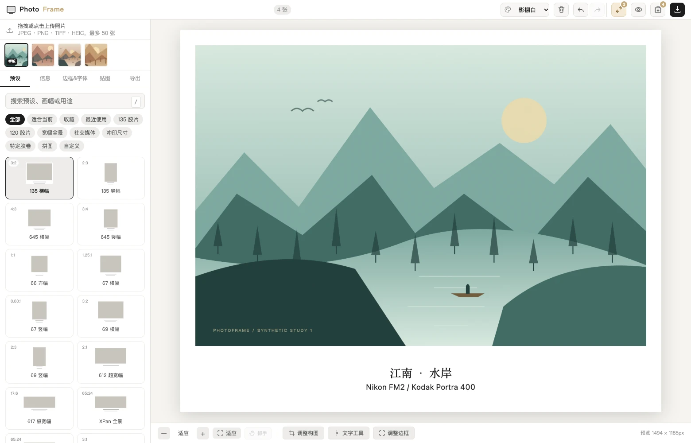

_真实界面截图。示例山水图在本地生成，不含个人照片；相机、胶卷和地点为手动填写的演示信息。_

## 可以做什么

| 模块           | 主要能力                                                                                                                    |
| -------------- | --------------------------------------------------------------------------------------------------------------------------- |
| **画幅与预设** | 30 个单图预设，覆盖 135、120（645 / 66 / 67 / 69）、XPan、612 / 617、社交平台与冲印用途；支持搜索、收藏、最近使用和画幅推荐 |
| **胶片边框**   | 133 款胶卷，含 85 款有 120 规格的胶卷。支持胶卷名与别名搜索、135 / 120 和片种筛选、自定义边字与 EXIF 变量 |
| **调整构图**   | 裁切、左右各旋转 90°、水平翻转与垂直翻转，已有裁切随照片变换 |
| **边框与背景** | 四边独立边距、圆角、纯色 / 渐变 / 纸张 / 亚麻 / 颗粒 / 网点，搭配描边、双线边框与阴影；可直接拖拽内外框                     |
| **照片信息**   | 读取可用 EXIF，手动补充地点与胶卷；主副标题模板、额外文字、字体与字号、对齐、拖动定位及自由变换                             |
| **贴图库**     | 320 个内置条目、9 个分类入口，包含胶卷、相机矢量 / 透明抠图、胶带和装饰；支持个人贴图、缩放、旋转、透明度、描边与阴影       |
| **地图叠层**   | 山地等高线、城市街道与水系。支持地名搜索、经纬度、照片 GPS、选点、底色与下缘渐隐 |
| **拼图工作台** | 18 套布局，配图槽、版面比例、留白、格子间距、圆角、材质、对齐和标题；可调整照片顺序                                         |
| **多图流程**   | 最多 72 张。底部胶片条可左右切换和多选、以当前照片为样板同步风格、撤销 / 重做、原图对比和 ZIP 批量导出                                      |
| **原分辨率导出** | 编辑时使用缩略图和轻量预览，单张和批量 ZIP 默认用原图渲染，边框向外扩展画布 |
| **使用体验**   | 影棚白、暗房黑、暖调纸张、深夜蓝四套界面主题；手机底部工具面板；本机会话恢复与预设 JSON 备份                                |
| **作品工具** | 照片自动配色、自定义字体与签名、选片标记、完整工程、联系表 JPG / PDF、多规格导出与连续多页排版 |

上述数量对应当前 `1.0.0` 的内置数据。EXIF 能读到哪些信息取决于原文件；胶卷型号与拍摄地点通常需要手动填写。

## 快速开始

仓库已包含运行所需的 `vendor/` 依赖，日常使用不需要构建：

```bash
git clone https://github.com/JackerKun/PhotoFrame.git
cd PhotoFrame
python3 -m http.server 8080 --bind 127.0.0.1
```

打开 **http://127.0.0.1:8080**。Windows 若没有 `python3` 命令，可改用 `py -m http.server 8080 --bind 127.0.0.1`。建议通过本地 HTTP 服务打开，便于贴图资源和离线缓存正常工作。

1. 拖入自己的照片，或先下载这张 [演示原图](docs/screenshots/demo-photo.jpg) 试用。
2. 导入时会逐张匹配最接近的画幅预设，自动保留完整画面。可在「预设」更换画幅或选胶片边框。
3. 在底部胶片条切换照片，用「调整构图」裁切或旋转翻转，也可在「信息」补充地点和胶卷。
4. 在「导出」选择 JPEG 或 PNG。默认使用原分辨率，点击右上角保存单张或打包 ZIP。

支持 JPEG / PNG / TIFF / HEIC / HEIF 导入，解码在本机进行；具体文件兼容性与浏览器内存有关。演示原图不含真实拍摄 EXIF。

## 界面导览

以下截图使用 4 张本地生成的示例图，展示桌面和 390 像素宽的手机视口。可点击 WebP 截图查看大图。

### 胶片边框

打开「预设 → 胶片边框」，可按 135 / 120、彩色或黑白负片、反转片、电影负片筛选。在「全部」的主搜索框输入 `Fuji`、`富士`、`Fuji Provia` 或 `Portra 400`，也会显示匹配的胶卷。135 模拟齿孔，齿孔默认白色且可自选颜色。120 使用无齿孔的连续边缘，两种规格都支持深色片基、浅色扫描和电影扫描。

横图的两条边字在上下两侧，竖图在左右两侧。可混用自由文字和变量，例如 `{stock} · 第 {frame} 帧 · {camera} · {shutter} · {iso}`。可用的 EXIF 信息会排印到成品边框。选好胶卷后可直接修改两条边字，也可以用「将当前参数保存为预设」保存样式。

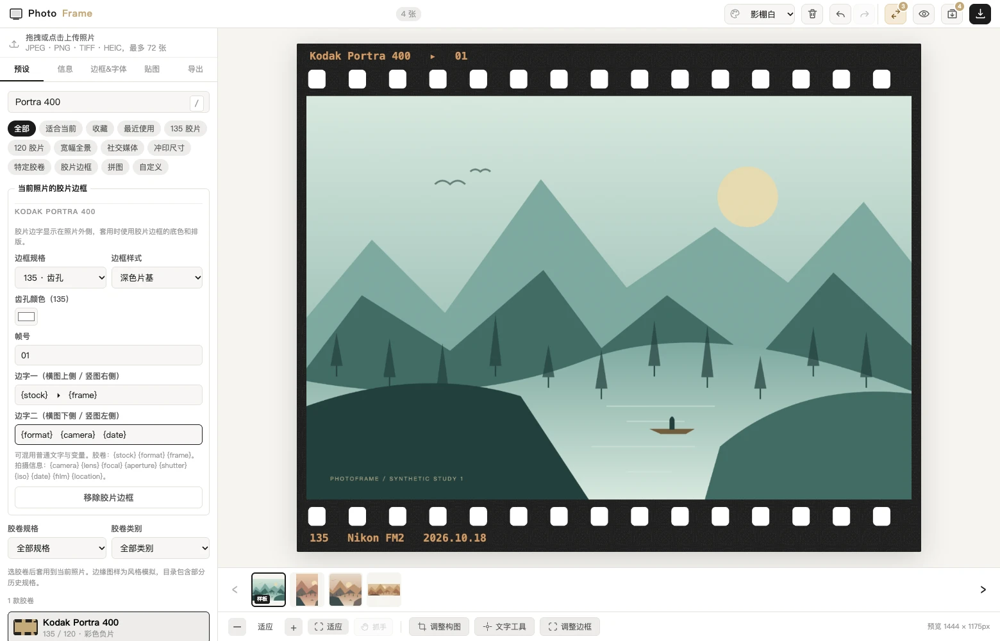

目录包含现售和历史规格，参考各厂商的胶卷目录。边缘图样为风格模拟。[Kodak Professional](https://www.kodakprofessional.com/photographers/resources)、[Kodak Still Film](https://www.kodak.com/en/still-film/products/)、[Fujifilm](https://wps-jp.fujifilm.com/filmlineup/)、[ILFORD](https://www.ilfordphoto.com/)、[Foma](https://www.foma.cz/en/catalogue-bw-film-324)、[Rollei](https://www.rolleianalog.com/produkte/)、[Lomography](https://www.lomography.com/magazine/327296-a-guide-to-lomography-films-and-formats)。

### 调整构图

在画布下方打开「调整构图」。拖动调整裁切位置，滚轮或双指捏合缩放，也可以用方向键微调。左转或右转 90°、水平翻转或垂直翻转时，已有裁切会随照片变换。点击「完成构图」或按 Enter 后应用到预览和导出，Esc 取消本次构图。进入构图会自动退出边框调整并隐藏其辅助线。

“宽幅全景”内置预设增加了上、左、右默认留白，并重新平衡底部信息区。恢复旧会话时，仍使用旧默认边框的内置预设会自动更新；自定义留白与照片单独调整的边框会保留。

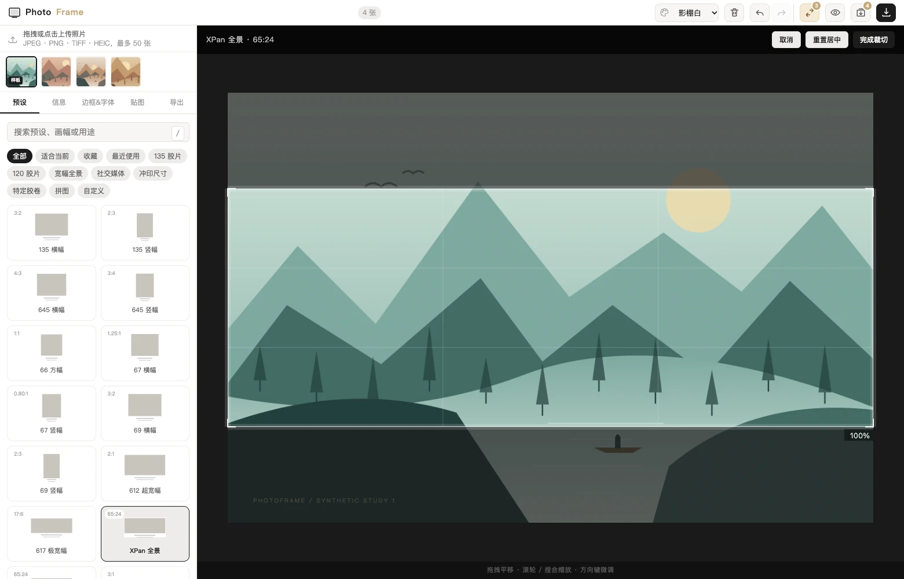

### 边框与文字：在画布上直接调整

**入口：** 导入照片 → “边框&字体”。调整四边比例和背景材质，再点击预览区底部“调整边框”，拖动四角或单边句柄。切换“文字工具”可拖动文字块并微调位置。

面板按画布背景、边框尺寸、照片边缘与景深、字体与排版、高级文字样式、额外文字行和文字位置分为 7 组，可独立折叠或全部展开 / 收起，并记住折叠状态。收起时显示当前配置摘要。主标题、副标题和额外文字行共用 49 个字体选项，涵盖 Windows、macOS 常见中西文字体；无需下载字体，优先列出检测到的本机可用字体，支持文字预览及最近使用；其他设备字体保留可选，未安装时由系统替代。字体检测结果可能受浏览器隐私设置影响。

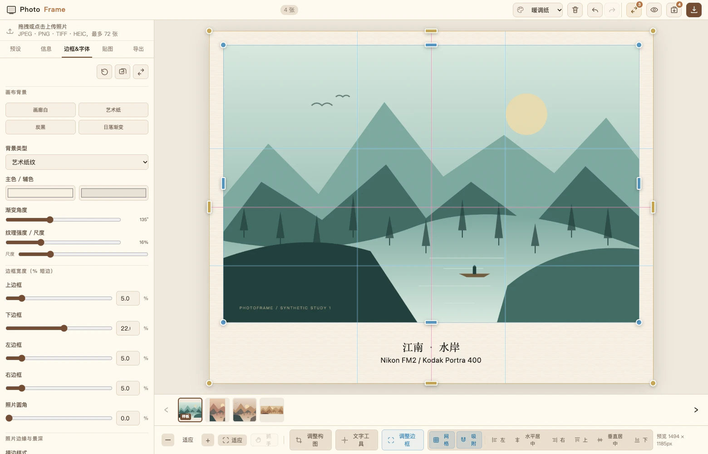

### 贴图库：胶卷、相机与个人装饰

**入口：** “贴图”→ 选择分类或搜索 → 点击素材添加。拖动贴图调整位置，拖角缩放、拖旋转柄旋转；左侧还可设置透明度、描边、阴影和层级。也支持上传自己的 PNG / JPG / WebP / SVG 素材。

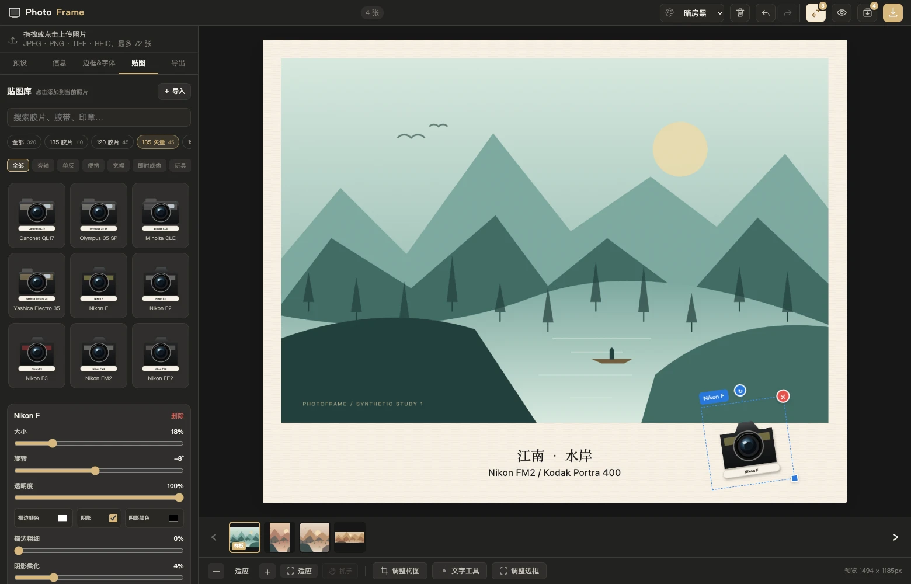

相机矢量插画与相机透明抠图是不同分类；照片及其衍生素材保留独立来源和许可入口，详见下方[素材与许可](#素材与许可)。

### 地图叠层

1. 导入照片，打开「贴图 → 地图叠层」。在「地图样式」里选「山地 · 等高线」或「城市 · 街道与水系」。
2. 点「试用 Val di Funes」或「试用圣彼得堡」加载内置样例。也可以搜索地名、输入纬度和经度，或用「使用照片 GPS」选取拍摄地点。选择地图宽度，再生成地图。
3. 在小地图上点选红点，把照片上的叠层拖到天空或留白处。地图宽度控制地理范围，贴图的「大小」控制它在照片上的尺寸。经纬度、海拔、比例尺和指北针可按需显示，海拔用于山地地图。
4. 在「地图背景」选透明或自定义底色，单独调整底色不透明度。白边上可以用「透明 + 深色线条」，也可以用「深色底 + 暖白线条」做成地图卡片。下缘渐隐控制地图线条如何融入照片。

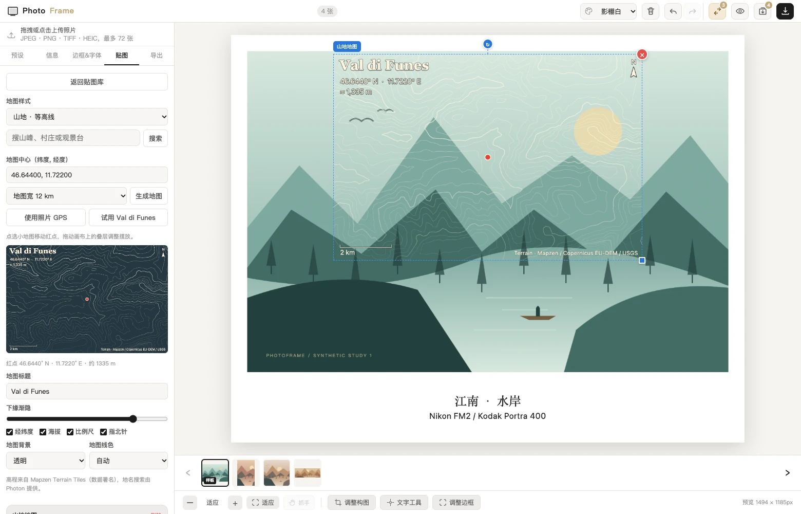

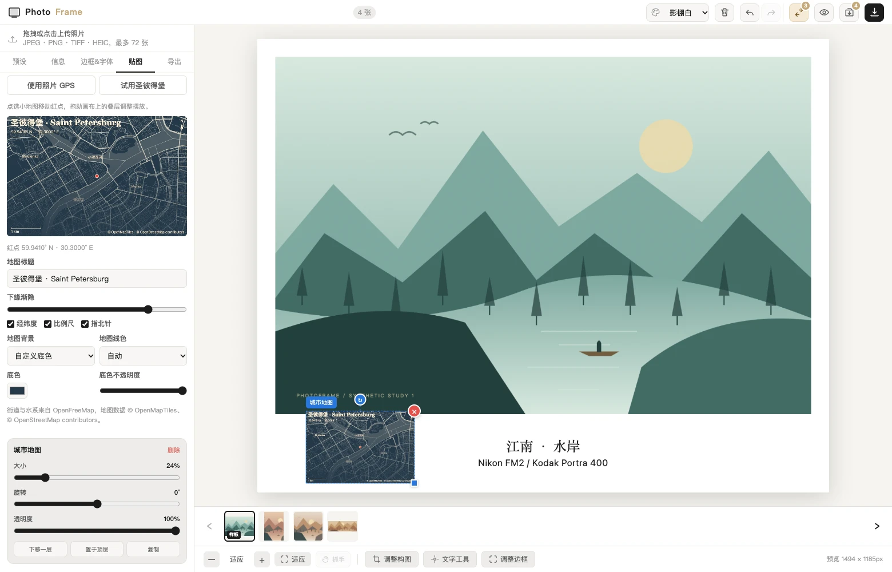

内置样例可离线使用。查询新地点或加载新范围时需要联网，照片合成和会话保存都在本机进行。单张和 ZIP 按成品尺寸重绘地图，原分辨率模式使用原图。数据来源及署名见[地图样例说明](assets/maps/README.md)。[地名搜索服务](https://github.com/komoot/photon)

### 拼图：配图、排版和风格在一个工作台完成

**快捷键：** Esc 优先关闭选照片弹框或取消格子构图；没有上层弹框时才退出拼图。格子构图中按 Enter 完成。

**外观：** 拼图入口与编辑器跟随顶部的整体主题切换，支持影棚白、暗房黑、暖调纸张和深夜蓝。

**入口：** 顶部工具栏点击 **拼图**，按“选择样式 → 选择照片 → 编辑与导出”完成作品。“预设 → 拼图”的旧入口也会进入选照片步骤。

1. 在独立入口中浏览 18 套样式卡片，点击想用的排列。每次新建都使用本次选择的布局。
2. 从照片库逐张选择，或点击 **上传照片** 从本机添加；无需提前导入照片。新上传照片会按剩余格数自动选中，多出的照片保留在图库。
3. 照片角标表示放入格子的顺序，可用 **前移 / 后移 / 移除** 调整。选满该样式需要的张数后，点击 **开始编辑**。
4. 左侧更换图槽或 **添加照片**，中间拖动构图，右侧按功能折叠设置，底部管理作品页面；点击 **导出拼图** 下载成品。
5. 要接着修改原作品，在独立入口点击 **继续上次拼图**。返回选样式或关闭新建窗口会保留原作品；确认开始编辑后创建新的作品。

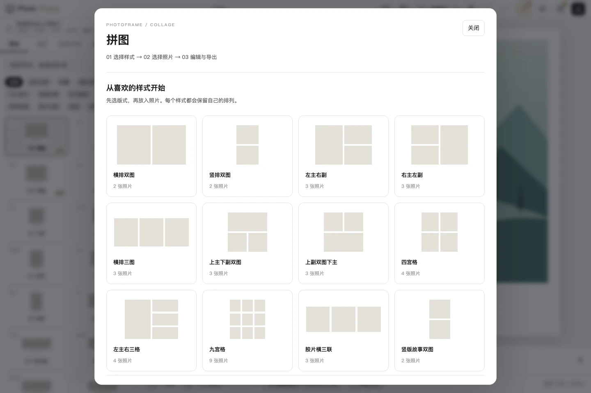

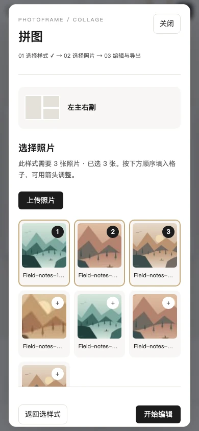

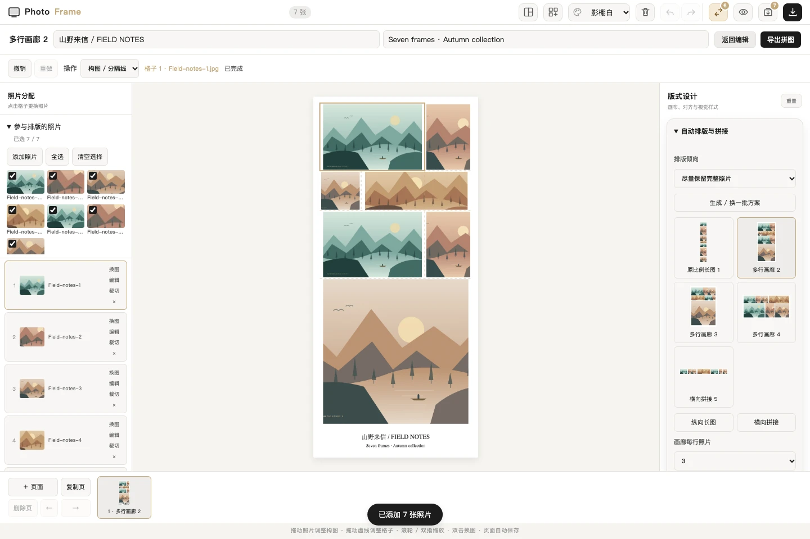

#### 自动排版与原比例拼接

1. 在左侧勾选参与排版的照片，可全选或清空选择。这里的选择只影响生成布局和自动分页。
2. 在右侧“自动排版与拼接”选择“尽量保留完整照片”“裁切铺满画布”或“突出主图”，点击“生成 / 换一批方案”。先比较实际照片缩略图，再点击一个候选应用。
3. 在画布上选中照片，使用“设为主图”指定主照片。“锁定格子”可保留该照片和所在区域，再生成方案只调整其他区域；所有格子锁定时需先解锁。
4. “纵向长图”同宽拼接，“横向拼接”同高拼接，“多行画廊”可选每行 2–6 张。三种方式保留完整照片，支持混合横竖图；可切到“交换照片”调整顺序。
5. 内置布局下拉框可以保留现有照片、文字和构图焦点切换版式。小布局容纳不下的照片仍在左侧照片库，可重新选择排版。

#### 直接编辑格子与构图

九宫格等多图布局使用有内存上限的独立预览缓存；连续缩放按屏幕帧合并绘制，未修改的作品页不重复生成缩略图。预览使用缩小图，导出仍使用原图。

- “构图 / 分隔线”模式：拖动格内照片平移构图，鼠标滚轮或手机双指缩放；拖动画布虚线调整相邻格子的大小。完整显示和继承边框的照片不做二次裁切。
- “交换照片”模式：把一张照片拖到另一个格子，两张照片及各自图注一起交换。锁定的格子不参与拖动和交换。
- 选中格子后，可以左右分格、上下分格，或点击“合并相邻格”再选择另一格。合并要求两格有完整共同边，保留先选格子的照片；被移出的照片仍在照片库。
- 双击画布中的格子或点击“更换照片”可选图；左侧仍保留独立裁切入口。“重置构图”回到居中裁切。
- 拼图有独立的撤销、重做，支持 Ctrl / Cmd + Z 和 Shift + Ctrl / Cmd + Z，最多保留 50 步。重新分页也可以撤销。

#### 摄影组图与可复用版式

- 在“摄影组图与版式库”选择原始照片、继承各照片当前编辑、统一白边或统一胶片边框。继承模式会保存应用时的边框、文字、贴图和单图构图快照；修改单图后需要重新应用。
- 每个格子的“照片说明”跟随照片移动；可以按文件名、顺序编号或相机 / 镜头 / 日期批量生成图注，统一设置图注字体和颜色，也可为整页设置标题与副标题字体。没有 EXIF 的图片建议使用文件名或自填说明。
- 填写名称并“保存当前版式”，下次选择版式后“使用版式”即可替换照片继续制作。最多保存 30 个，包含布局、样式、标题和图注，不包含照片本身；同名保存会覆盖。

#### 多页作品、封面与连续轮播

1. 在底部新增、复制、删除页面，点击页面缩略图切换。桌面可以拖动排序，手机也可用前移 / 后移按钮。每页可独立设置照片、布局、标题和图注，最多 72 页，每页最多 72 格。
2. 在“多页作品与导出”选择每页照片数，点击“用所选照片重新分页”。可自动使用首张和末张制作封面与结束页；重新分页会替换现有页面，可撤销。
3. 用“将本页样式应用到所有页”统一背景、画布比例、间距和字体，保留各页照片、布局和文字。需要统一画布比例时，先给当前页选一个明确比例，再应用到所有页。
4. 顶部“导出拼图”只保存当前页；“全部页 ZIP”按页序导出 JPEG / PNG；“连续长卷”将同一比例的页面横向连接。多页导出长边可设 320–12000 px，长卷总宽上限 30000 px、总像素上限 6400 万，超过时会提示降低尺寸。
5. “将本页布局加入连续轮播”会复制一个保留照片源与排版的组合元素，到“作品工具 → 连续多页”后可继续移动、缩放、跨页排版和切页导出。组合内部的格子在拼图工作台编辑，重新加入可更新。

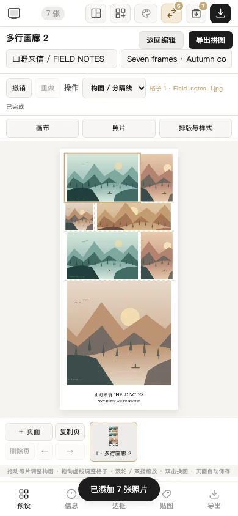

手机端使用上方“画布 / 照片 / 排版与样式”按钮或左右滑动切换面板，底部页面条支持横向滑动和鼠标滚轮。页面会随本机会话保存；跨浏览器备份请保存 `.photoframe` 工程，工程包含全部拼图页面和已保存版式。关闭“保存原始照片”后，刷新恢复仍受原图未持久化的限制。

<details>
<summary>批量同步：统一风格，同时保留每张照片自己的内容</summary>

**入口：** 先完成一张样板 → 点击顶部双向箭头“同步当前修改”。选择后续、已选或全部其他照片；默认同步画幅、边框、文字样式和贴图，保留每张的文字内容与裁切。确实需要一致时，再开启“文字内容”或“构图裁切”。整次同步可以一次撤销。

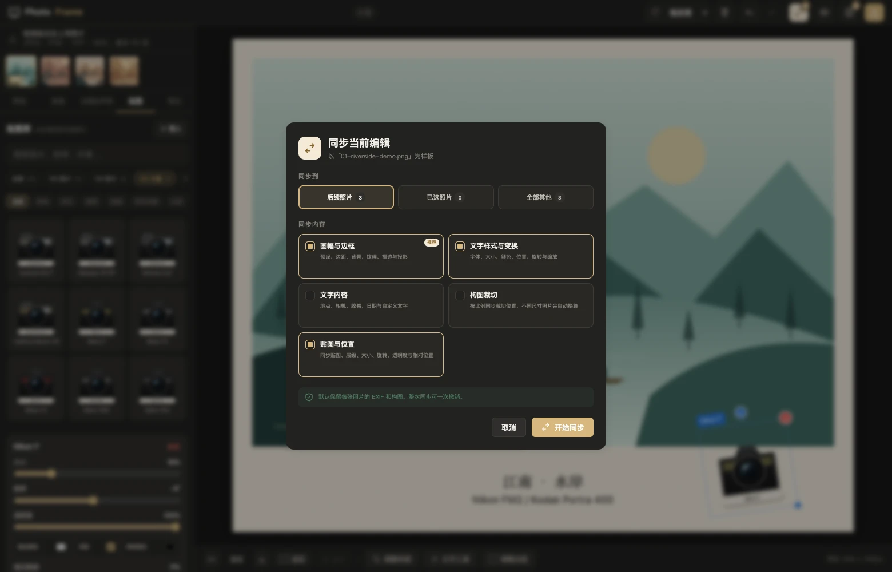

</details>

<details>
<summary>导出：JPEG / PNG、质量、分辨率与文件名模板</summary>

**入口：** “导出”。可选 JPEG / PNG，JPEG 质量为 70–100%；默认按原始分辨率导出，也可手动指定照片长边为 1500 / 2400 / 3000 / 4500 / 6000 px。支持 `{name}`、`{index}` 等文件名变量，单张保存或批量 ZIP。尺寸语义见[导出与离线说明](#导出与离线说明)。

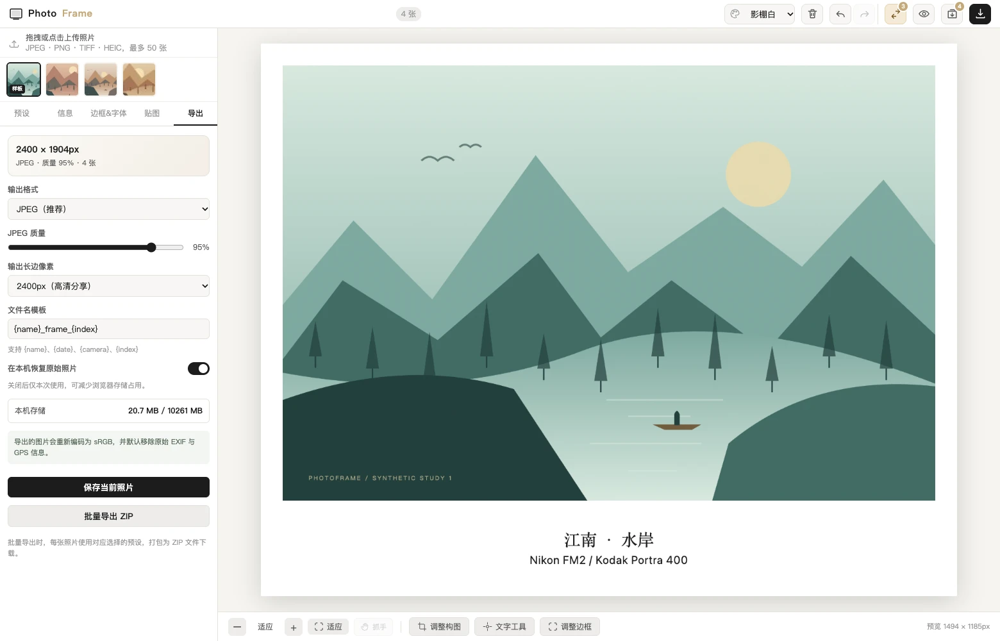

</details>

### 手机：预览画布与底部工具面板

底部导航切换“预设 / 信息 / 边框&字体 / 贴图 / 导出”；工具以底部面板展开，点击遮罩可回到预览。预览工具栏使用紧凑图标，支持画布缩放和抓手查看。

<p align="center">
  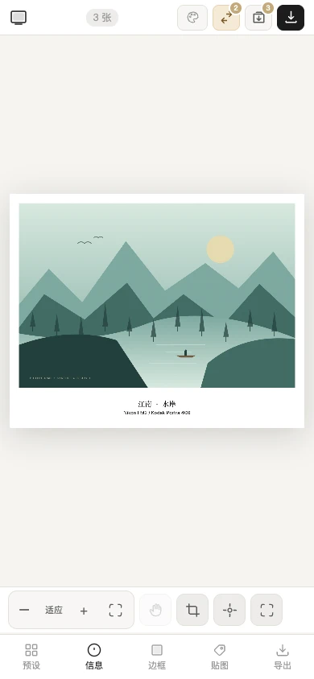
  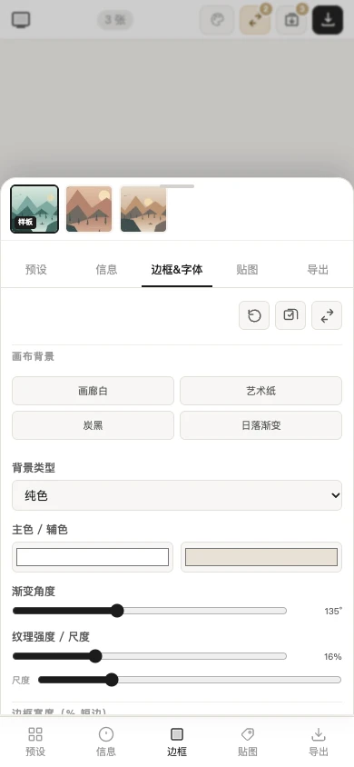
</p>

<details>
<summary>实际导出成品示例</summary>

下图由程序真实导出的 JPEG 转为 WebP，便于文档展示。可下载 [JPEG 原文件](docs/screenshots/result.jpg) 查看实际成品；示例设置照片长边 2400 px，加入边框后的文件为 **2560 × 2032 px**。

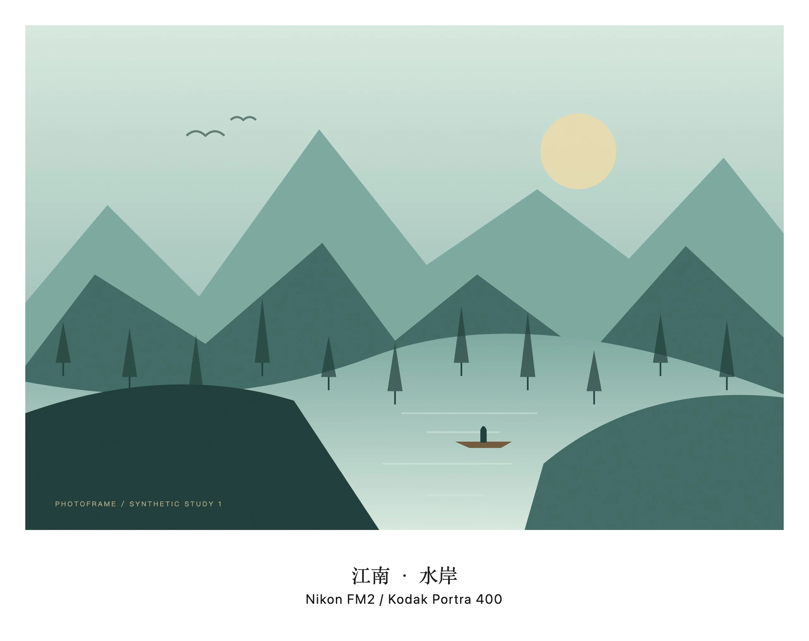

</details>

## 推荐工作流

**单张：** 导入 → 选画幅 → 填信息 → 调边框 / 文字 / 贴图 → 检查构图 → 保存。

**多张统一风格：**

1. 一次导入这一组照片，先完成第一张样板。
2. 点击“同步当前修改”，选择“后续照片”或其他目标；保持推荐选项即可保留各图自己的信息与构图。
3. 底部胶片条可横向滚动，也可用两侧按钮切换。焦点在胶片条时支持 ← / →。用 `Ctrl / ⌘` 增减同步目标，或用 `Shift` 连续选择。
4. 单独补全每张的文字和构图，再点“批量导出 ZIP”。

批量导出会弹出进度窗口，显示当前照片缩略图、文件名、等待队列、完成 / 失败状态与 ZIP 打包进度。支持取消（当前处理结束后停止，不下载本次 ZIP），失败原因直接显示，可仅重试失败照片。重复文件名自动追加序号，避免 ZIP 内覆盖。完成后点击“完成”返回编辑。横向列表提供导航箭头与边缘提示，选中项自动进入可视区域。使用普通鼠标时，将指针放在贴图分类、标签或照片胶片条上，滚动滚轮即可左右浏览。

**保存自己的风格：** 在“预设”中点击“将当前参数保存为预设”。更换设备或清理浏览器数据前，使用“导出预设”保存 JSON；之后可用“导入预设”恢复。

主副标题支持 `{location}`、`{camera}`、`{film}`、`{date}`、`{iso}`、`{aperture}`、`{shutter}`、`{lens}` 等变量。它们引用每张照片已有的 EXIF 或手动信息，不能从像素内容推断胶卷型号。

## 作品工具：成套设计与交付

点击顶部四格图标打开 **作品工具**，或使用背景、字体与导出面板里的快捷入口。窗口顶部依次是“配色与签名、选片、工程、联系表、多规格导出、连续多页”。分类与处理范围固定在顶部，下面的卡片内容可独立滚动；手机端使用纵向卡片，分类栏可横向浏览。

先确认顶部的 **处理范围**：全部照片、仅保留、仅待定，或胶片条中选中的照片。范围会影响配色、签名、批量标记、联系表、多规格输出与多页自动排版；旁边显示范围内的照片数。**胶片条筛选只控制显示，不会自动改变处理范围；原有“批量导出 ZIP”仍导出全部照片。**

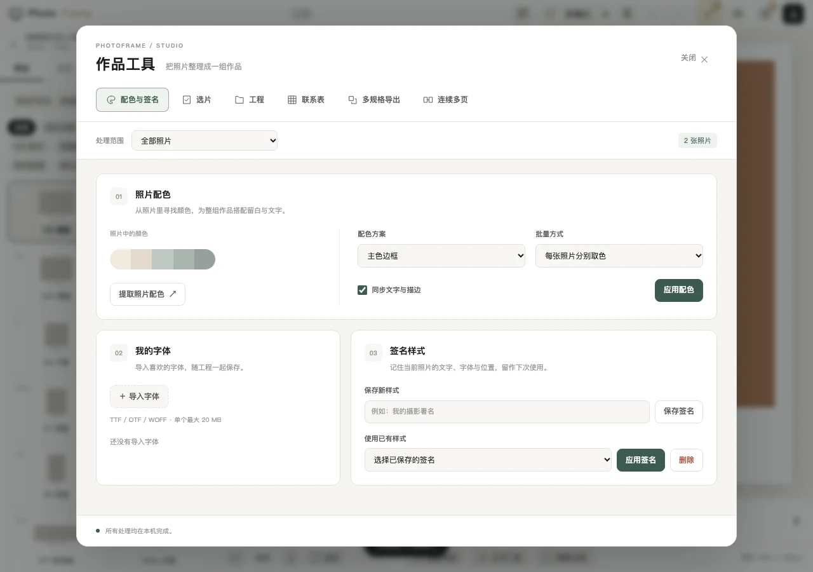

### 从照片自动配色

1. 在胶片条中选中作为参考的照片，打开“配色与签名”。
2. 点击 **提取照片配色**，获得最多 6 个主色。点击色块选择颜色；纯色照片可能只有一个色块。
3. 选择“主色边框、浅色留白、深色展览”，按需勾选“同步文字与描边”。
4. 选择批量方式：“每张照片分别取色”会为各图生成自己的颜色；“整组使用当前选色”会统一使用所选色块。
5. 核对处理范围，点击 **应用配色**。普通边框与胶片边框都支持自动配色；切换胶片明暗样式后会恢复该样式的默认配色。

### 导入字体与保存签名

- 在“我的字体”卡片点击 **导入字体**，选择 TTF / OTF / WOFF / WOFF2 文件，单个最大 20 MB。导入成功后，可在原编辑器的主标题、副标题和额外文字字体列表中选择。字体仅保存在当前浏览器，并随完整工程打包。
- 保存签名前，先在原编辑器中完成当前照片的文字模板、字体、字号、对齐和位置。在“签名样式”卡片输入名称，点击 **保存签名**。
- 在“使用已有样式”下拉框中选择样式，再点 **应用签名**，应用到当前处理范围。此操作会替换目标照片的标题、副标题与额外文字设置；照片的 EXIF 和手动信息字段保留，模板变量仍按各图解析。
- **删除**只移除已保存的签名样式，不会撤回已应用到照片的文字。

### 选片：保留、待定与排除

打开“选片”，点击缩略图可切换当前照片；每张卡片的下拉框可修改标记。新照片默认待定。顶部的“胶片条筛选”可只显示某类标记；批量标记按钮作用于顶部 **处理范围**。标记会随会话和完整工程保存。

只交付保留照片时，将处理范围设为“仅保留”，然后进入联系表或多规格导出。标记为排除不会删除原图。

### 保存与打开完整工程

1. 打开“工程”，点击 **保存 .photoframe 工程**，下载工程文件。
2. 要继续编辑，点击 **选择工程文件**，等待检查并阅读摘要。
3. 先保存当前工作，再点击 **打开已检查的工程**；它会替换当前工作区。

完整工程包含原图、每张照片的编辑、预设、自定义贴图、导入字体、签名、全部拼图页面与版式库、多页排版、导出方案及联系表等交付设置。工程文件与解压后数据均限制为 1 GB；浏览器内存可能限制更小的工程。关闭“在本机恢复原始照片”时，打开的工程可在本次会话中编辑，但原图不会写入会话恢复存储。

| 保存方式 | 包含内容 | 适用场景 |
| --- | --- | --- |
| 预设 JSON | 自定义预设与预设管理信息，不含原图 | 备份或分享样式 |
| 本机会话恢复 | 当前浏览器与站点内的编辑数据；原图保存受开关控制 | 刷新后继续编辑 |
| 完整工程 `.photoframe` | 原图、编辑、字体、自定义素材及排版等 | 长期备份、换浏览器或设备继续编辑 |

完整工程保留原片及其元数据，不能当作已移除 GPS 的分享成品。

### 生成胶卷联系表

1. 在“联系表”中填写标题，设置每页列数与行数，均支持 2-8。
2. 选择“简洁选片”或“胶片收藏”，按需勾选“显示文件名、日期与器材”。编号和选片标记始终显示。
3. 点击 **预览首页** 检查版面；更改布局后需再次预览。
4. 点击 **导出 JPG** 下载按页打包的 ZIP，或点 **导出 PDF** 下载多页文档。超过一页的照片会自动分页，PDF 页面采用栅格图像。

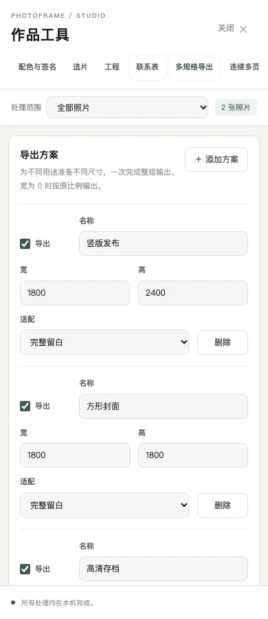

### 一次导出多个规格

1. 在“多规格导出”的“导出方案”卡片勾选需要的方案。可新增、命名和删除方案，最多 12 个。
2. 设置宽、高与适配方式：“完整留白”保留完整成品并补背景；“裁切填满”会裁掉超出画幅的部分。宽为 0 时按原比例输出，高度字段作为长边设置，边框可能扩大实际成品尺寸。
3. 在“文件与拍摄信息”中选择 JPEG 或 PNG。JPEG 大小上限单位为 MB，0 为不限；超限时会降低质量，必要时降低尺寸。PNG 不使用这个上限。
4. “拍摄信息附档”默认不附带元数据。可选择不含 GPS 的拍摄信息 JSON，或明确选择包含 GPS 的 JSON；**图片本身始终移除原始 EXIF / GPS**，画面上的文字不受影响。
5. 在胶片条中切换到要检查的照片，打开“检查裁切”，选择预览方案，用水平与垂直滑块调整位置，再点击 **预览并估算大小**。裁切位置按照片和方案分别保存；滑块主要影响“裁切填满”的结果。
6. 点击 **导出所选方案 ZIP**，按方案分文件夹下载。包内的“导出说明.txt”记录实际尺寸与文件大小；调整尺寸、格式或上限后请重新预览。

### 连续多页图文与切页导出

1. 在“连续多页”设置页数、单页宽高和背景。支持 2-10 页；单页宽 320-2400 px、高 320-3000 px。
2. 点击 **＋ 当前照片** 或 **＋ 文字** 添加元素，也可点击 **自动排版**，用处理范围内的照片重新生成布局。自动排版会替换已有多页元素。
3. **取消勾选“滑动浏览”后拖动元素**，可将照片或文字移到页边界两侧。也可在“编辑元素”中选择元素，精确修改坐标、尺寸、旋转、适配、字体与文字。
4. 使用“上移一层、下移一层”调整遮挡关系；“删除元素”只删除当前排版元素。勾选“滑动浏览”后可滑动长画布，手机端默认开启；普通鼠标滚轮也支持横移，两侧箭头可翻页。
5. “参考线”控制页线与安全区域。点击 **切页导出 ZIP**，得到按页编号的 JPEG。参考线与选中框不会进入成品。

多页排版会在本机记住，也包含在完整工程中；移除原照片时，其对应的多页照片元素也会移除。更改照片编辑后，重新进入“连续多页”可刷新照片预览。

导出与工程打包时可查看进度并取消；取消后不下载部分结果，可能需要等待当前照片处理结束。

## 导出与离线说明

| 问题                                    | 实际行为                                                                                                                                               |
| --------------------------------------- | ------------------------------------------------------------------------------------------------------------------------------------------------------ |
| **选了 2400 px，为什么文件更大？**      | 单图分辨率按照片区域的长边计算，边框会增加成品尺寸。                                 |
| **原始尺寸是否包含边框？**              | 默认的原分辨率模式用原图渲染，未裁切时保留照片像素尺寸，边框在外侧扩展画布。手动裁切后按保留区域的像素计算。                                                                                 |
| **会保留原片信息吗？**                  | 成品由 Canvas 重新编码，不拷贝原片 EXIF / GPS；画面上可见的拍摄信息文字仍会保留。原文件不会被覆盖。                                                    |
| **能离线使用吗？**                      | 本地 HTTP 服务运行时，仓库内资源不依赖外网。远程网站需先成功加载并刷新，让 Service Worker 接管；之后可用已缓存资源。按需加载的素材要先访问过才有缓存。 |
| **为什么另一浏览器没有上次会话？**      | 会话文件在当前浏览器、当前站点的 IndexedDB；自定义预设与偏好使用 localStorage。切换端口、浏览器、无痕模式或清理站点数据，会影响恢复。                  |
| **为什么照片导入 / 高分辨率导出失败？** | HEIC / TIFF 文件的编码与浏览器内存会影响解码；可先转为 JPEG / PNG，或降低输出尺寸、减少同时处理的照片。                                                |

预设 JSON 备份不包含导入的原照片；需要连同原片、字体和排版一起保存时，请使用“作品工具 → 工程”。打印前请另外核对文件像素、目标纸张尺寸和输出方要求。

## 开发与检查

运行界面本身不需要 Node.js。更新依赖、运行自动化检查或重新生成截图时，使用 Node.js 20+（建议当前 LTS）：

```bash
npm ci
npm run vendor              # 仅在更新本地 vendor 副本时需要
npm run check
npx playwright install chromium
npm test
```

Playwright 覆盖桌面与手机视口。实现采用原生 JavaScript、HTML5 Canvas、exifr、heic2any、UTIF、JSZip 与 FileSaver.js；无前端构建步骤。技术设计见 [TECHNICAL_SPEC.md](TECHNICAL_SPEC.md)。

维护者可用 `node scripts/screenshots.cjs` 复现本文界面，生成示例素材与成品。截图使用独立浏览器上下文，不打开个人浏览器会话；默认需要已安装 Google Chrome。详细方法见 [截图说明](docs/screenshots/README.md)。

PDF 使用说明由本文的用户章节生成，修改后可重新生成（需要 Python、`reportlab` 与支持中文的 TrueType 字体）：

```bash
python3 -m pip install reportlab
python3 scripts/build-user-guide.py --font /path/to/chinese.ttf
```

macOS 默认尝试系统的 Arial Unicode 字体；其他系统可用 `--font` 或 `PHOTOFRAME_DOC_FONT` 指定字体。

## 目录结构

```text
PhotoFrame/
├── index.html / css/          # 入口与响应式界面
├── js/
│   ├── app.js                # 编辑状态、交互与工作流
│   ├── creative-tools.js     # 配色、签名、选片、工程与成套交付
│   ├── font-library.js       # 系统与导入字体选择
│   ├── presets.js            # 单图画幅与样式预设
│   ├── canvas-renderer.js    # 照片、边框、文字与贴图渲染
│   ├── film-stocks.js / film-frame.js  # 胶卷目录与胶片边框
│   ├── terrain-map.js / city-map.js / terrain-map-editor.js  # 地图数据、绘制和编辑
│   ├── crop-editor.js / photo-orientation.js  # 裁切、旋转与翻转
│   ├── collage-layouts.js    # 拼图布局与渲染
│   ├── sticker-library.js    # 贴图与素材分类
│   ├── image-decoder.js      # 本地格式解码
│   ├── exif-reader.js        # 拍摄信息读取
│   ├── batch-processor.js    # 批量导出
│   └── storage.js / session-store.js
├── assets/                   # 相机素材与来源许可
├── vendor/                   # 随仓库分发的浏览器依赖
├── docs/screenshots/         # 实拍界面、演示原图和导出示例
├── scripts/                  # 依赖同步、素材处理和截图工具
├── tests/                    # Playwright 自动化检查
└── sw.js / manifest.webmanifest
```

## 素材与许可

`package.json` 声明项目代码使用 MIT。第三方依赖及素材保留各自许可，相机照片与衍生透明抠图的来源分别记录在 [相机照片归属](assets/cameras/ATTRIBUTION.json) 和 [透明抠图归属](assets/camera-cutouts/ATTRIBUTION.json)；它们不统一按项目代码许可授权。界面也提供素材来源入口。

README 中的示例山水图由截图脚本本地生成，不使用个人照片。问题反馈请附浏览器、文件格式与复现步骤，提交到 [Issues](https://github.com/JackerKun/PhotoFrame/issues)。
